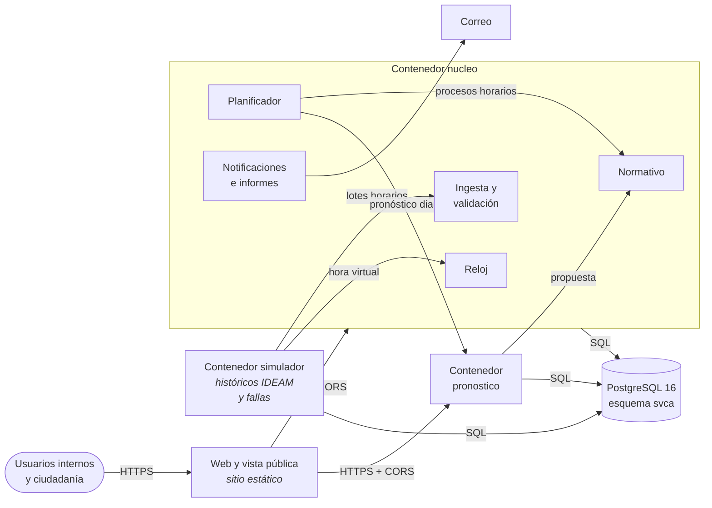

# Vigilancia de la calidad del aire y pronóstico de PM10 en el corredor Sogamoso-Nobsa (Boyacá)

Trabajo de grado del programa de Ingeniería de Software de la Universidad Manuela Beltrán (UMB), línea de investigación en Desarrollo de software.

## Qué es

Un sistema web para vigilar el material particulado PM10 en el corredor industrial Sogamoso-Nobsa con los criterios de la Resolución 2254 de 2017. Recibe las mediciones horarias de las estaciones, las valida y permite revisarlas sin tocar el dato crudo. Calcula los promedios móviles de 24 horas, evalúa los niveles de prevención, alerta y emergencia y propone la declaratoria al coordinador. Además emite cada día un pronóstico a 24 horas con intervalo de predicción, notifica por correo, genera el informe mensual en PDF y publica una vista ciudadana con el índice de calidad del aire.

Como no hay acceso a la red de estaciones en tiempo real, un **simulador** reproduce los datos históricos del IDEAM con un **reloj virtual** e inyecta fallas controladas. Sirve para medir las reglas de validación y para reproducir un año en menos de 30 minutos.

## Arquitectura

Hay siete servicios con responsabilidad acotada y contrato OpenAPI propio: reloj, planificador, ingesta y validación, normativo, pronóstico, notificaciones e informes, y el simulador. Se despliegan en **tres contenedores**:

- `nucleo`: reloj, planificador, ingesta, normativo y notificaciones.
- `pronostico`: se puede detener sin afectar al resto (RNF-15).
- `simulador`: fuente de datos sustituible (RNF-04).



Los servicios no se importan entre sí: se hablan por HTTP, también dentro del mismo contenedor, y import-linter lo comprueba en CI. Todos comparten una base PostgreSQL 16 (esquema `svca`), pero cada uno se conecta con un rol que solo puede escribir sus propias tablas. Ningún servicio toma la hora del sistema: todos se la piden al reloj.

Decisiones y su justificación:

- [ADR-0001: arquitectura de servicios](docs/adr/0001-arquitectura-de-servicios.md)
- [ADR-0002: stack](docs/adr/0002-stack.md)
- [ADR-0003: despliegue gratuito](docs/adr/0003-despliegue-gratuito.md)

## Cómo levantarlo

Requisitos: Docker con Compose. Para desarrollar, además [uv](https://docs.astral.sh/uv/) y Node LTS.

```bash
docker compose -f infra/docker-compose.yml up --build
```

Levanta la base de datos, aplica los scripts de `db/`, arranca los tres contenedores, la web en <http://localhost:8080> y el servidor de correo de pruebas en <http://localhost:8025>. No hace falta crear ningún archivo `.env`; los valores por defecto sirven en local.

Para desarrollar sin contenedores:

```bash
uv sync
uv run ruff check . && uv run mypy && uv run lint-imports
uv run pytest -m unitaria
```

## Datos

La fuente es el conjunto *Calidad del Aire en Colombia* del IDEAM (datos.gov.co, `g4t8-zkc3`), con datos de 2020 a 2024 de cinco estaciones de Corpoboyacá: UPTC, El Recreo, SENA, Nazaret y Bomberos. La estación MOVIL KOICA (31828) se excluye porque sus coordenadas la ubican en Tunja. El perfil de calidad está en [`docs/datos/perfil_calidad.md`](docs/datos/perfil_calidad.md).

Los datos crudos y los modelos no se suben al repositorio. Para regenerarlos:

```bash
python tools/filtrar_ideam.py <export_nacional.csv> data/raw/ideam_corredor.csv
python tools/perfil_datos.py
```

## Estructura

```
db/                     scripts SQL del esquema svca (01 a 10 del documento y los que se agregan)
docs/                   documento, ADR, contratos OpenAPI, backlog, planes, perfil de datos
servicios/
  comun/                piezas compartidas sin reglas de negocio
  ingesta/              ingesta, validación, revisión, sesiones y red
  normativo/            promedios, evaluación normativa y declaratorias
  pronostico/           modelo y pronóstico diario
  notificaciones/       correos e informes en PDF
  planificador/         procesos periódicos gobernados por el reloj
  nucleo/               composición del contenedor nucleo
simulador/
  reloj/                servicio de reloj (corre en nucleo)
  estaciones/           simulador de estaciones (contenedor propio)
web/                    interfaz interna y vista pública
infra/                  Dockerfiles, docker-compose.yml y despliegue
tests/                  pruebas unitarias, de integración, de arquitectura y de humo
tools/                  herramientas de datos, base de datos y llaves
```

## Cómo se trabaja

Scrum con sprints de dos semanas y CRISP-DM para el modelo. El backlog está en [`docs/backlog.md`](docs/backlog.md) y el avance en [`docs/ESTADO.md`](docs/ESTADO.md). Hay una rama por historia con PR a `main`, y los mensajes de commit referencian la historia (`HU-07: ...`).

## Autor

Daniel, estudiante de Ingeniería de Software, Universidad Manuela Beltrán.
