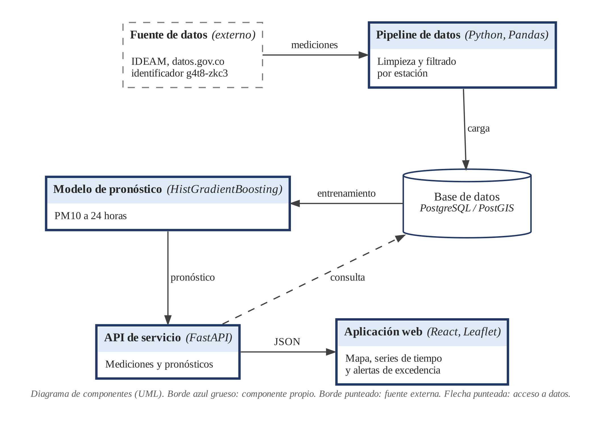

# Software web de vigilancia de la calidad del aire y pronóstico de PM10 en el corredor industrial Sogamoso-Nobsa, Boyacá

Trabajo de grado del Programa de Ingeniería de Software de la Universidad Manuela Beltrán (UMB), en la línea de investigación de Desarrollo de software.

## Descripción

El proyecto es un sistema web de vigilancia de la calidad del aire pensado para uso institucional. Muestra las mediciones de material particulado PM10 del corredor industrial Sogamoso-Nobsa (Boyacá, Colombia) y las acompaña de un pronóstico a 24 horas generado con un modelo de aprendizaje automático. El sistema incluye niveles de confianza para cada pronóstico y alertas cuando se prevé una excedencia diaria.

## Alcance

El modelo trabaja solo con PM10. El PM2.5 se trata a nivel conceptual porque las estaciones no tienen datos completos de ese contaminante. La zona de estudio es el corredor Sogamoso-Nobsa, y Paipa queda fuera por falta de datos públicos. Los datos van de 2022 a 2024, con entrenamiento sobre 2022 y 2023 y prueba sobre 2024.

## Arquitectura



Los datos del IDEAM pasan por un pipeline de limpieza y se cargan en PostgreSQL con PostGIS. El modelo se entrena con esa base y entrega sus pronósticos a una API en FastAPI, que también consulta las mediciones y responde en JSON a la aplicación web.

## Datos

La fuente principal es el conjunto Calidad del Aire en Colombia del IDEAM, publicado en datos.gov.co con el identificador `g4t8-zkc3`. Las estaciones provienen de la red de Corpoboyacá y son SENA, BOMBEROS, UPTC, EL RECREO y NAZARETH-JAC. La estación MOVIL KOICA (ID 31828) se excluye porque sus coordenadas la ubican en Tunja.

## Modelo

El modelo principal es `HistGradientBoostingRegressor`, con un horizonte de 24 horas. Se compara contra dos líneas base, persistencia y regresión Ridge.

## Tecnologías

| Capa | Tecnología |
|---|---|
| Aprendizaje automático | Python, Pandas, scikit-learn, joblib |
| Backend | FastAPI |
| Base de datos | PostgreSQL con PostGIS |
| Frontend | React, Leaflet |

## Estructura del repositorio

```
.
├── README.md
├── docs/        documento del trabajo de grado, diagramas y manuales
├── data/        datos del proyecto
├── notebooks/   exploración y entrenamiento
├── backend/     API en FastAPI
└── frontend/    aplicación web
```

Esta estructura es inicial y cambiará a medida que avance el desarrollo.

## Autor

Daniel, estudiante de Ingeniería de Software, Universidad Manuela Beltrán.

## Estado

En desarrollo.
