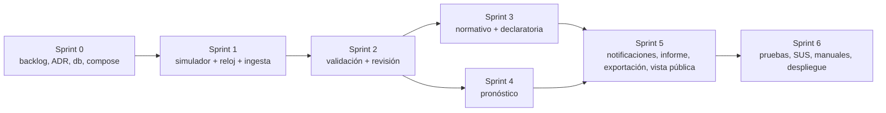

# Trazabilidad: requisito → caso de uso → proceso → dónde se implementa → sprint

Armada con las Tablas 5, 9, 14, 15 y 19 y con las secciones 3.6.6 y 3.6.8 del documento.
Las celdas que el documento no fijaba (RF-12, RF-14, RF-15) se decidieron en el backlog y en los ADR.

| RF | Qué | CU | Proceso | Carpeta | Tablas principales | Sprint |
|---|---|---|---|---|---|---|
| RF-01 | Recibir mediciones horarias por API | CU-01 | P-02 | `servicios/ingesta` | medicion | 1 |
| RF-16 | Reproducir históricos con reloj virtual e inyectar fallas | CU-14 | P-01 | `simulador` | escenario_simulacion, falla_inyectada | 1 |
| RF-02 | Validación automática (rango, repetido, cambio brusco, entre estaciones) | CU-02 | P-03, P-04 | `servicios/ingesta` | medicion (estado, regla_aplicada), periodo_mantenimiento | 2 |
| RF-03 | Revisión manual con justificación | CU-03 | P-05 | `servicios/ingesta`, `web` | revision | 2 |
| RF-04 | Dato crudo inmutable y auditoría de cambios | CU-03 | P-02, P-05 | `db` (disparador), `servicios/ingesta` | medicion, revision, registro_auditoria, v_medicion_valida | 2 |
| RF-05 | Promedios móviles 24 h y representatividad 75 % | CU-05 | P-06 | `servicios/normativo` | promedio_movil | 3 |
| RF-06 | Evaluar niveles cada hora y proponer declaratoria | CU-05 | P-07 | `servicios/normativo` | evaluacion_normativa, evaluacion_promedio, parametro_normativo | 3 |
| RF-07 | Confirmar o descartar la propuesta | CU-06 | P-07 | `servicios/normativo`, `web` | declaratoria, declaratoria_estacion | 3 |
| RF-08 | Pronóstico diario 24 h con intervalo y categoría ICA | CU-07 | P-08 | `servicios/pronostico` | pronostico, valor_pronosticado, version_modelo, ejecucion_ciclo | 4 |
| RF-09 | Comparar pronóstico con observado | CU-08 | P-09 | `servicios/pronostico`, `web` | valor_pronosticado | 4 |
| RF-10 | Notificar por correo a salud y gestión del riesgo | CU-09 | P-10 | `servicios/notificaciones` | notificacion, contacto | 5 |
| RF-11 | Informe mensual en PDF | CU-10 | P-11 | `servicios/notificaciones` | informe | 5 |
| RF-12 | Exportar datos validados | CU-11 | P-12 | `servicios/ingesta` | v_medicion_valida | 5 |
| RF-13 | Vista pública con ICA y pronóstico | CU-12 | — | `web` | (lectura) | 5 |
| RF-14 | Usuarios y roles | CU-13, CU-15 | — | `servicios/ingesta` (sesiones y usuarios), `servicios/comun` (verificación en cada API), `web` | usuario, rol | 1 (tokens) y 2 (usuarios, web) |
| RF-15 | Estaciones, variables y parámetros como configuración | CU-13 | — | `servicios/ingesta` (red), `servicios/normativo` (parámetros), `servicios/notificaciones` (contactos), `web` | estacion, variable, estacion_variable, parametro_normativo, contacto | 3 (red y parámetros) y 5 (contactos) |

## Orden de construcción

Historias por RF y por RNF: tablas al inicio de `docs/backlog.md`. En qué contenedor corre cada carpeta: `servicios/{ingesta,normativo,notificaciones,planificador}` y `simulador/reloj` en `nucleo`; `servicios/pronostico` en `pronostico`; `simulador/estaciones` en `simulador` (ADR-0001).

Los RNF que atraviesan todo: RNF-02 (sin fuga temporal), RNF-04 (fuente sustituible), RNF-05 y RNF-17 (seguridad), RNF-09 (OpenAPI), RNF-15 (si falla el pronóstico lo demás sigue), RNF-19 (cobertura), RNF-20 (un solo archivo de orquestación).
