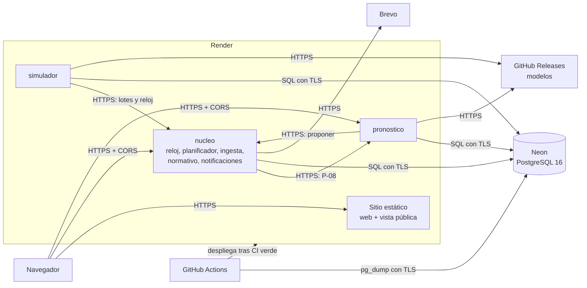

# ADR-0003: Despliegue gratuito y permanente

- Estado: Aceptado. Los límites de los planes se consultaron el 2026-11-15 y cambian con frecuencia: hay que volver a comprobarlos al crear cada cuenta (tarea 9 de `docs/planes/sprint-0-construccion.md`) y antes del Sprint 6.
- Fecha: 2026-11-15
- Sprint: 0 (cierra la decisión abierta "proveedor de nube", que estaba prevista para el Sprint 6)
- Relacionado: 3.6.7, Figura 43; RNF-08, RNF-16, RNF-17, RNF-20; RNF-01, RNF-10, RNF-11; ADR-0001, ADR-0002

## Contexto

El proyecto no tiene presupuesto. Todo debe ser gratuito **y permanente**: no sirven pruebas de 30 días ni créditos que vencen, porque el sistema tiene que seguir en línea el día de la sustentación y después. Tampoco conviene depender de una tarjeta de crédito.

La sección 3.6.7 pide un servidor en la nube con contenedores, PostgreSQL gestionado con conexión cifrada, HTTPS para los usuarios, el simulador en un contenedor aparte y un servidor de correo de pruebas. ADR-0001 redujo el sistema a tres contenedores de aplicación precisamente para que esto quepa.

## Decisión

| Pieza | Proveedor y plan | Límites del plan gratuito | Cómo se vive dentro de ellos |
|---|---|---|---|
| Contenedores `nucleo`, `pronostico` y `simulador` | **Render**, servicios web gratuitos, desplegados desde el `Dockerfile` de cada unidad | 512 MB de memoria y CPU compartida por servicio. Se duerme tras 15 minutos sin tráfico entrante y tarda cerca de un minuto en despertar. 750 horas de instancia al mes para toda la cuenta; las horas dormidas no cuentan y al agotarse se suspenden los servicios hasta el mes siguiente. Sin disco persistente. Sin salida por los puertos 25, 465 y 587. Sin tareas programadas ni consola | Tres servicios en lugar de siete (ADR-0001). Nada se guarda en disco. Correo por API. Presupuesto de horas abajo |
| Web interna y vista pública | **Render**, sitio estático gratuito (construido con Vite desde `web/`) | No se duerme; HTTPS y CDN incluidos | La vista pública carga al instante aunque las APIs estén dormidas, y muestra "consultando..." mientras despiertan |
| Base de datos | **Neon**, plan gratuito, PostgreSQL 16, misma región que Render | 1 GB de almacenamiento por proyecto (las escrituras fallan al superarlo, no se cobra). 100 horas de cómputo al mes a 1 CU (unas 400 horas al tamaño mínimo). Se suspende a los 5 minutos sin consultas y despierta en menos de un segundo. Ventana de restauración de 6 horas. Hasta 10 ramas | Presupuesto de almacenamiento abajo. Conexión por el agrupador de Neon con TLS obligatorio |
| Correo | **Brevo**, plan gratuito, API transaccional por HTTPS | 300 correos al día. Remitente verificado por dirección, sin dominio propio | El sistema envía decenas de correos por declaratoria, no cientos. En local y en CI se usa Mailpit |
| Planificador de procesos de dominio (P-04, P-06, P-07, P-08) | El planificador propio, dentro de `nucleo` (ADR-0002) | Los de Render | Sigue al reloj de dominio. No usa ningún cron del proveedor |
| Tareas programadas de operación (copia de seguridad, restauración de prueba, prueba de humo) | **GitHub Actions** con `schedule` | Gratis en repositorios públicos. La hora de disparo puede retrasarse varios minutos. GitHub desactiva los flujos programados tras 60 días sin actividad en el repositorio | Ninguna de estas tareas necesita puntualidad. El repositorio tiene actividad continua hasta la sustentación; después basta reactivarlos |
| CI | **GitHub Actions**, ejecutores estándar | Gratis y sin tope de minutos mientras el repositorio sea público (3.6.10 lo declara público) | ruff, mypy, import-linter, pytest con PostgreSQL 16 de servicio, cobertura, construcción de imágenes y prueba de humo del compose |
| Repositorio de modelos y archivo histórico normalizado | **GitHub Releases** del mismo repositorio | Gratis; 2 GB por archivo | El `.joblib` no entra al árbol de git (regla de `CLAUDE.md`); se publica como adjunto de una versión. Los datos del IDEAM son abiertos |
| Dominio y certificados | Subdominios `*.onrender.com` | Sin dominio propio | HTTPS automático del proveedor |

No se requiere tarjeta en ninguna de las cuentas según la documentación consultada. Si alguna la pidiera al registrarse, se detiene y se revisa este ADR antes de aceptar.

### Topología

### Presupuestos

**Horas de instancia (750 al mes).** El sistema en la nube es un entorno de demostración: está despierto solo cuando alguien lo usa o corre un escenario. Un escenario acelerado mantiene despiertos los tres servicios, es decir, tres horas de bolsa por hora real. Una demostración de un año de datos dura menos de una hora; diez ensayos al mes no llegan a 50 horas. Lo que no cabe es un escenario a velocidad 1 durante semanas: tres servicios despiertos de forma continua agotan la bolsa en diez días. Esos escenarios largos se corren en el compose.

**Mientras un escenario está en ejecución, nada debe dormirse.** El simulador solo hace llamadas salientes, así que Render lo dormiría a los 15 minutos y con él se detendría todo. Mientras haya un escenario `EN_EJECUCION`, el simulador llama cada 10 minutos a su propia URL pública de salud y a la de `pronostico`. Cuando el escenario termina o se pausa, deja de hacerlo y los servicios se duermen solos. Si aun así el proveedor reinicia un contenedor, la recuperación ya está diseñada: el simulador retoma desde `reloj_actual` y el reloj arranca congelado en esa hora (`docs/planes/reloj-virtual.md`, secciones 3.5 y 4.4).

**Almacenamiento (1 GB).** Un año de las cinco estaciones con todas sus variables son unas 360 000 mediciones, cerca de 100 MB con índices; los promedios, evaluaciones y pronósticos derivados suman otro tanto. La nube carga como máximo **dos años** de mediciones a la vez. El entrenamiento del modelo no pasa por esta base: lee el archivo histórico normalizado en el equipo de desarrollo. `tools/` incluye una orden que vacía los datos de un escenario terminado, y la prueba de humo diaria avisa si la base supera 700 MB.

**Cómputo de la base (100 horas CU).** La base solo cuenta mientras hay consultas. Los grupos de conexiones se configuran con mínimo cero y el bucle del planificador en reposo consulta el reloj, que no toca la base, de modo que un sistema ocioso deja suspender a Neon.

**Memoria (512 MB por contenedor).** El archivo histórico de la nube se limita al periodo de demostración. WeasyPrint y matplotlib se importan solo al generar un informe. El servicio de pronóstico carga un único modelo.

### Sin disco: dónde va lo que el documento guarda en archivos

- **Modelos** (`version_modelo.ruta_artefacto`): nombre del adjunto en GitHub Releases, que incluye su SHA-256. El servicio lo descarga al arrancar o al activar una versión y rechaza el archivo si el resumen no coincide. En local la misma columna admite una ruta de archivo.
- **Informes PDF** (`informe.archivo_pdf`): el contenido se guarda en la base, en una tabla nueva `informe_archivo` (`db/12`, Sprint 5), y la columna guarda su identificador. Doce informes al año de menos de 2 MB no pesan en el presupuesto y quedan dentro de la copia de seguridad. Es una desviación del modelo de 24 tablas y va en `docs/correcciones_documento.md`.
- **Llaves y secretos**: variables de entorno del proveedor. La llave privada de los tokens solo en `nucleo`.

### Correo de pruebas en la nube

3.6.7 exige que durante las pruebas los correos no lleguen a las entidades reales. En local y en CI eso lo hace Mailpit, que captura todo. En la nube no hay dónde alojarlo gratis, así que el servicio de notificaciones tiene un **modo de redirección** (`SVCA_CORREO_REDIRIGIR_A`): mientras esté configurado, todo mensaje se envía a ese único buzón de prueba, con el destinatario original en el asunto. Es el estado por defecto del despliegue y una prueba comprueba que, con la variable puesta, ningún otro destinatario sale del sistema.

### Cómo se cumplen los tres requisitos de despliegue

**RNF-08 (contenedores en un proveedor de nube).** Las tres unidades son imágenes Docker que Render construye desde el repositorio y ejecuta como contenedores. El despliegue es automático al integrar en `main`, condicionado a que CI esté en verde. La verificación es una prueba de humo contra las URL públicas: salud de los tres servicios, inicio de sesión y una reproducción corta. La definición de los servicios queda versionada en `infra/render.yaml`.

**RNF-20 (un único archivo de orquestación).** `infra/docker-compose.yml` levanta el sistema completo en un equipo limpio con una orden: PostgreSQL 16, el migrador que aplica `db/`, `nucleo`, `pronostico`, `simulador`, la web y Mailpit. No depende de ninguna cuenta externa. CI lo ejecuta en cada integración, que equivale a una instalación en equipo limpio repetida a diario. `infra/render.yaml` no es un segundo archivo de orquestación: describe el mismo sistema para un proveedor concreto, con las mismas imágenes.

**RNF-16 (copia diaria y restauración probada).**

1. Un flujo programado de GitHub Actions ejecuta cada día `pg_dump` en formato personalizado contra Neon, cifra el archivo con una clave guardada en los secretos del repositorio y lo guarda como artefacto con 90 días de retención. Se cifra porque el repositorio es público y la base contiene correos de contactos y resúmenes de contraseñas.
2. Un flujo semanal toma la copia más reciente, la restaura en un PostgreSQL 16 limpio dentro del propio flujo y comprueba el número de tablas, la existencia del disparador de `valor_crudo` y los conteos por tabla. Eso es la "restauración en un entorno de prueba", repetida cada semana y con registro.
3. `docs/manuales/restauracion.md` describe el procedimiento manual hacia Neon o hacia el compose (HU-54).
4. Segunda línea: la restauración a un punto en el tiempo de Neon, dentro de sus 6 horas.

**RNF-17 (HTTPS).** Render solo publica por HTTPS y redirige HTTP. Neon exige TLS; las cadenas de conexión usan `sslmode=verify-full`. Brevo y GitHub se consumen por HTTPS. En el compose local el tráfico es HTTP dentro de la red de contenedores.

### Qué RNF se miden dónde

Los planes gratuitos dan CPU compartida y arranques en frío. Los requisitos de desempeño se verifican en el **entorno de referencia**, que es el compose en el equipo de desarrollo y en CI, y el resultado de la nube se reporta como dato informativo:

| RNF | Entorno de verificación |
|---|---|
| RNF-01 (cinco minutos), RNF-10 (dos segundos), RNF-11 (un año en 30 minutos) | Compose. En la nube se mide y se reporta, sin umbral |
| RNF-08, RNF-16, RNF-17 | Nube |
| RNF-15 | Ambos |
| RNF-20 | Compose en equipo limpio y en CI |

## Alternativas descartadas

- **Oracle Cloud Always Free (máquina virtual).** Permitiría el compose completo en un servidor, que es la lectura literal de la Figura 43. Se descarta porque exige tarjeta, redujo su cuota gratuita en 2026, rara vez hay capacidad para crear la máquina y Oracle recupera las instancias que considera inactivas: es un riesgo que no se puede correr la semana de la sustentación.
- **Koyeb.** Tras su compra dejó de aceptar cuentas gratuitas nuevas sin tarjeta.
- **Fly.io y Railway.** No tienen plan gratuito permanente; solo crédito de prueba.
- **Google Cloud Run.** Su nivel gratuito es permanente y generoso, pero exige cuenta de facturación con tarjeta y puede generar cobros. Es el **plan B** si Render retira su plan gratuito: las mismas tres imágenes se despliegan sin cambios.
- **PostgreSQL gratuito de Render.** Se borra a los 30 días.
- **Supabase.** Pausa los proyectos tras siete días sin uso y hay que reactivarlos a mano. Es el plan B de la base de datos: es PostgreSQL estándar y `db/` se aplica igual.
- **Servidor SMTP (Gmail, Brevo por el puerto 587).** Render bloquea esos puertos en el plan gratuito.
- **Mailtrap u otro capturador alojado.** Su cuota gratuita mensual es muy baja; el modo de redirección da la misma garantía sin otra cuenta.
- **Mantener todo despierto con pings permanentes.** Tres servicios encendidos sin pausa necesitan 2 200 horas al mes; la bolsa es de 750.

## Consecuencias

- **La primera petición tras un rato de inactividad tarda hasta un minuto.** Para la sustentación: abrir el sistema diez minutos antes y dejar corriendo un escenario, que mantiene todo despierto. La web lo indica en lugar de mostrar un error.
- **En la nube no hay operación continua en modo real.** Con el núcleo dormido el planificador no dispara. No afecta al alcance: la única fuente de datos es el simulador y, mientras reproduce, todo está despierto. Una operación real con estaciones transmitiendo necesitaría una instancia siempre encendida; el diseño no cambia, solo el plan. Se dice de forma explícita en el documento y en el manual técnico.
- **La base de datos es accesible desde internet** (con TLS y una contraseña por rol), porque la lista de direcciones permitidas es de pago. El criterio de HU-53 "la base no es accesible desde internet" se reemplaza por: solo conexiones cifradas, un rol por servicio con privilegios mínimos, contraseñas generadas y guardadas solo en los secretos del proveedor.
- **El despliegue empieza en el Sprint 0, no en el 6.** Un esqueleto con `/salud` queda en línea desde el principio y cada sprint termina desplegado. El Sprint 6 se dedica a endurecer y medir, no a descubrir el proveedor a última hora.
- **Dependencia de planes que el proveedor puede cambiar.** Mitigación: imágenes Docker estándar, PostgreSQL estándar, configuración por variables de entorno, planes B identificados y copia de seguridad fuera del proveedor de la base.
- La Figura 43 y el texto de 3.6.7 deben actualizarse (`docs/correcciones_documento.md`).

## Fuentes consultadas (2026-11-15)

- Render, "Deploy for Free": https://render.com/docs/free
- Neon, límites del plan gratuito: https://neon.com/faqs/free-plan-limits-and-quotas y https://neon.com/docs/introduction/plans
- Brevo, servidor de correo gratuito: https://www.brevo.com/free-smtp-server
- GitHub, precios de Actions en 2026: https://resources.github.com/actions/2026-pricing-changes-for-github-actions/
- Oracle, recursos Always Free: https://docs.oracle.com/en-us/iaas/Content/FreeTier/resourceref.htm
- Koyeb, preguntas sobre precios: https://www.koyeb.com/docs/faqs/pricing
