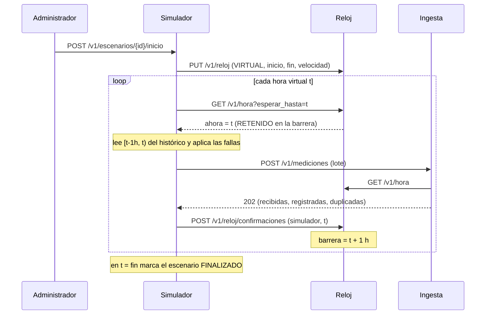

# Contratos de API

Contratos de diseño en OpenAPI 3.1 (RNF-09). El OpenAPI que genera cada servicio debe coincidir con estos archivos; una prueba por servicio compara rutas, métodos, códigos de respuesta y campos obligatorios (ADR-0002).

| Archivo | Interfaz | Quién la ofrece | Quién la consume | Sprint |
|---|---|---|---|---|
| `reloj.yaml` | IReloj | Servicio de reloj (contenedor `nucleo`) | Todos los servicios, simulador, planificador | 1 |
| `ingesta.yaml` | IRecepción y sesiones | Servicio de ingesta (contenedor `nucleo`) | Simulador o fuente real; web | 1 (crece en el 2) |
| `simulador.yaml` | Control de la simulación (CU-14) | Simulador (contenedor propio) | Web (administrador) | 1 |

La Figura 42 no dibuja interfaces para CU-13, CU-14 ni CU-15. Las sesiones y el control de la simulación de estos archivos cubren ese vacío (ADR-0002).

## Quién llama a quién en el Sprint 1

## Convenciones comunes

- **Versión en la ruta**: `/v1/...`. Cada contrato describe las rutas del servicio arrancado solo.
- **Dónde se publica cada servicio** (ADR-0001): los servicios del núcleo se montan bajo su nombre, `https://<nucleo>/<servicio>/v1/...` (`/reloj`, `/ingesta`, `/normativo`, `/notificaciones`); `pronostico` y `simulador` publican `/v1/...` en su propio contenedor. Ningún cliente arma estas rutas: cada uno recibe la URL base del servicio por configuración (`SVCA_URL_RELOJ`, `SVCA_URL_INGESTA`, ...). No hay proxy.
- **Mismo contrato, dos transportes**: dentro del núcleo las llamadas entre servicios usan el transporte en proceso; desde fuera, HTTPS. El token, la validación y los códigos de respuesta son idénticos.
- **CORS**: cada API acepta solo los orígenes de `SVCA_ORIGENES` (la web). Los tokens viajan en `Authorization`, nunca en cookies.
- **Nombres en español y sin tildes** en rutas, campos y códigos (`contrasena`, `estacion`).
- **Fechas**: RFC 3339 con desplazamiento explícito en la entrada, UTC con `Z` en la salida. Las horas de medición son intervalos `[inicio, fin)` de una hora exacta.
- **Estaciones y variables se identifican por `codigo`**, no por `id`: una fuente real no conoce las llaves internas.
- **Errores**: siempre `{codigo, mensaje, errores[]}`. El programa decide por `codigo`; `mensaje` es para personas. Los errores de contrato responden 400 con la lista completa, no solo el primero.
- **Autenticación**: `Authorization: Bearer <JWT RS256>`. Solo `/v1/salud` y `POST /v1/sesiones` son anónimos. Cada servicio verifica la firma con la llave pública y decide por la lista `permisos` del token, no por el nombre del rol.

## Permisos que usan estos contratos

| Permiso | Operaciones | Roles que lo tienen |
|---|---|---|
| cualquiera (token válido) | `GET /v1/hora` | todos |
| `ingesta` | `POST /v1/mediciones` | `SERVICIO`, `SIMULADOR` |
| `procesos_programados` | `POST /v1/reloj/confirmaciones` | `SERVICIO`, `SIMULADOR` |
| `simulacion` | `PUT /v1/reloj`, pausa, reanudación; todo `simulador.yaml` | `ADMINISTRADOR`, `SIMULADOR` |
| `consultar_red` | `GET /v1/mediciones` | `TECNICO` |

El rol `SIMULADOR` no existe en `db/10`. Se agrega en `db/11_roles_servicios.sql` (HU-06) con los permisos `{ingesta, procesos_programados, simulacion}`. No se le da `simulacion` al rol `SERVICIO` porque ese es el rol que usaría una fuente de datos real, y una fuente real no debe poder mover el reloj.

## Tiempo

- La hora de dominio sale siempre de `GET /v1/hora`. La ingesta fecha `recibida_en` con ella y rechaza mediciones futuras.
- El vencimiento de los tokens y las duraciones usan la hora real y el reloj monótono (ADR-0002).
- Si el reloj no responde, quien lo necesita falla con 503 y no recurre a la hora del sistema.
- **Arranque en frío** (ADR-0003): en la nube un contenedor dormido tarda cerca de un minuto en responder la primera petición. Los clientes entre contenedores (simulador → núcleo, núcleo → pronóstico) usan un tiempo límite de 120 s en la primera llamada y reintentan; un 502 o 503 del proveedor mientras despierta se trata como error pasajero.
- RNF-01 (dato validado y evaluado en menos de cinco minutos) se mide con duraciones reales, no restando horas de dominio: en una reproducción acelerada cinco minutos virtuales son milisegundos.

## Puntos abiertos

1. **Decimales del histórico.** `valor_crudo` es `NUMERIC(10,3)`. Si el perfil de los datos IDEAM muestra valores con más de tres decimales, hay que ampliar la columna (desviación del documento) en lugar de redondear en el simulador: redondear es modificar el dato crudo.
2. **Zona horaria del histórico.** Los archivos del IDEAM vienen en hora local. El simulador convierte a UTC al leer (Colombia es UTC-5 todo el año). Hay que confirmarlo en el perfil de datos.
3. **Reloj tras finalizar un escenario.** Queda congelado en la última hora hasta que alguien lo pase a `REAL`. Si el servicio de reloj se reinicia en ese estado, arranca en `REAL`.
