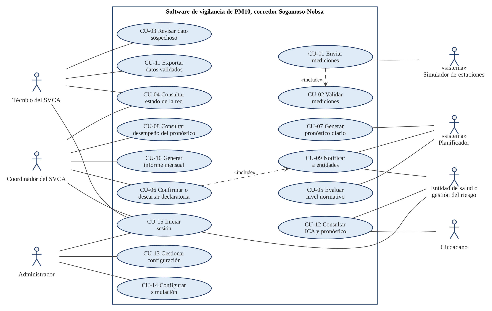

<!-- Generado por tools/docx_a_conocimiento.py desde el .docx. No editar a mano: editar el Word y regenerar. -->

### 3.2.3 Casos de uso de alto nivel

La Tabla 9 presenta los quince casos de uso de alto nivel y la Figura 1 su diagrama general. Los actores humanos aparecen a la izquierda y los actores de sistema a la derecha, junto con la entidad de salud, que es actor secundario de la notificación. El diagrama tiene dos relaciones de inclusión. El envío de mediciones (CU-01) incluye siempre su validación (CU-02), porque ningún dato queda disponible sin pasar por las reglas, y la confirmación de una declaratoria (CU-06) incluye la notificación a las entidades (CU-09). El inicio de sesión (CU-15) es requisito de todos los casos internos y se dibuja una sola vez para no cargar el diagrama.

**Tabla** **9.** *Casos de uso de alto nivel*

|            |                                    |                         |                                                                                   |
| ---------- | ---------------------------------- | ----------------------- | --------------------------------------------------------------------------------- |
| **Código** | **Caso de uso**                    | **Actor principal**     | **Descripción**                                                                   |
| CU-01      | Enviar mediciones                  | Simulador de estaciones | Envía lotes de mediciones horarias al servicio de ingesta                         |
| CU-02      | Validar mediciones                 | Incluido en CU-01       | Aplica las reglas automáticas y asigna una bandera a cada dato                    |
| CU-03      | Revisar dato sospechoso            | Técnico del SVCA        | Aprueba, corrige o invalida datos marcados como sospechosos                       |
| CU-04      | Consultar estado de la red         | Técnico del SVCA        | Visualiza completitud, estaciones caídas y datos pendientes                       |
| CU-05      | Evaluar nivel normativo            | Planificador            | Calcula promedios móviles y propone un nivel según los artículos 11 y 12          |
| CU-06      | Confirmar o descartar declaratoria | Coordinador del SVCA    | Decide sobre la propuesta de nivel con soporte técnico                            |
| CU-07      | Generar pronóstico diario          | Planificador            | Estima el PM10 de las siguientes 24 horas por estación                            |
| CU-08      | Consultar desempeño del pronóstico | Coordinador del SVCA    | Compara valores pronosticados y observados                                        |
| CU-09      | Notificar a entidades              | Planificador            | Envía avisos a los contactos de salud y gestión del riesgo                        |
| CU-10      | Generar informe mensual            | Coordinador del SVCA    | Produce el informe en PDF a partir de datos validados                             |
| CU-11      | Exportar datos validados           | Técnico del SVCA        | Descarga los datos en el formato de carga definido                                |
| CU-12      | Consultar ICA y pronóstico         | Ciudadano               | Accede a la vista pública de solo lectura                                         |
| CU-13      | Gestionar configuración            | Administrador           | Administra usuarios, roles, estaciones y parámetros normativos                    |
| CU-14      | Configurar simulación              | Administrador           | Define periodo, velocidad del reloj y fallas a inyectar                           |
| CU-15      | Iniciar sesión                     | Usuario autenticado     | Valida credenciales, aplica el bloqueo por intentos y asigna los permisos del rol |

Fuente: Elaboración propia.

**Figura** **1.** *Diagrama general de casos de uso*

Fuente: Elaboración propia.
