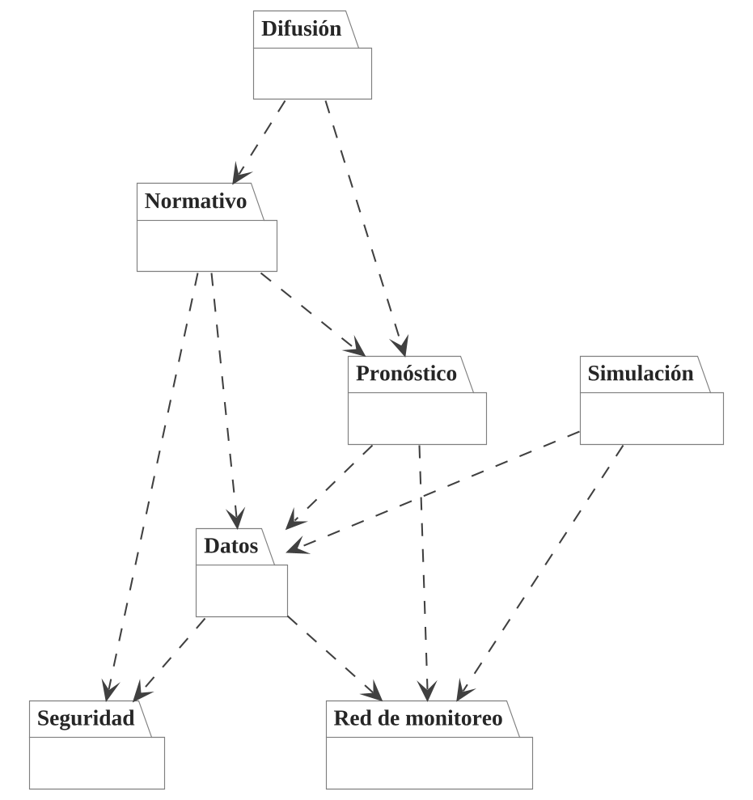
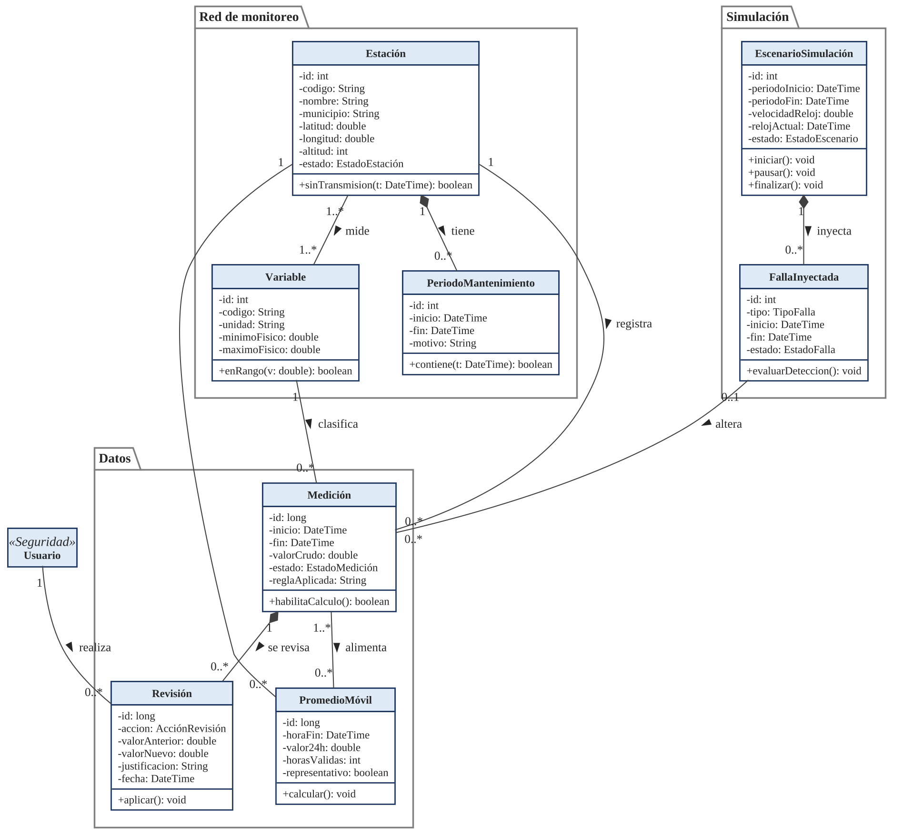
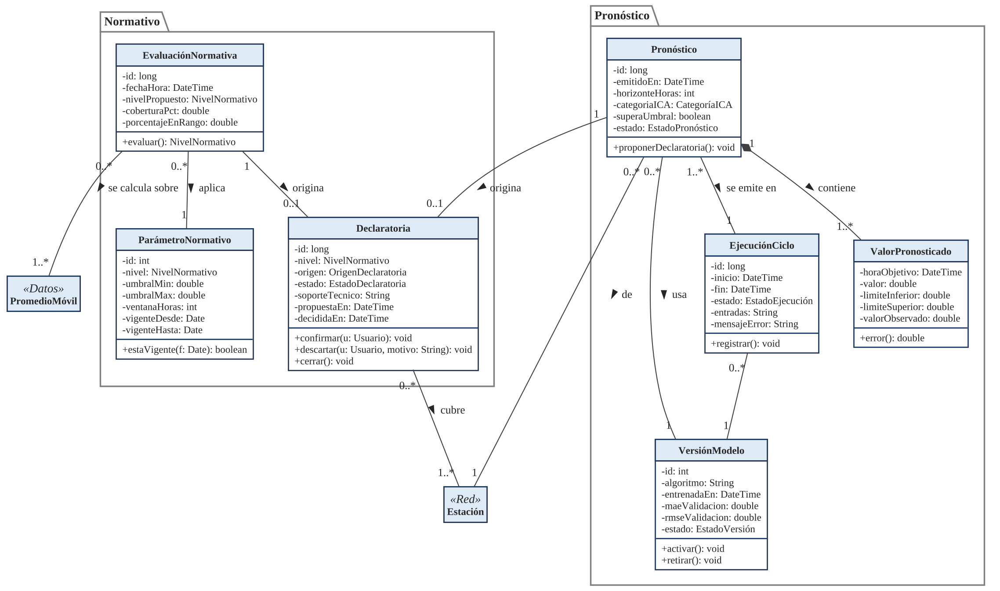
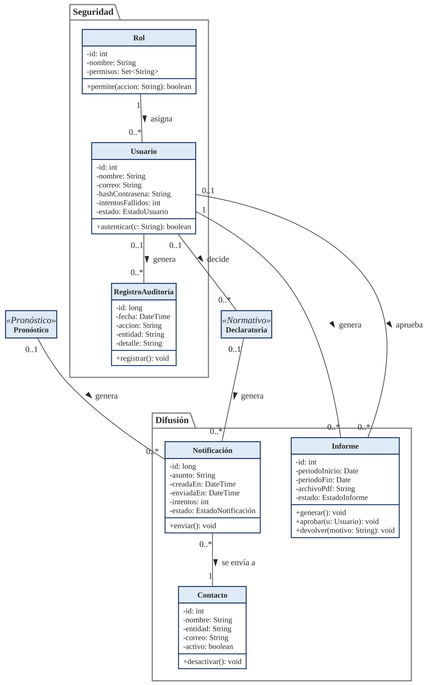
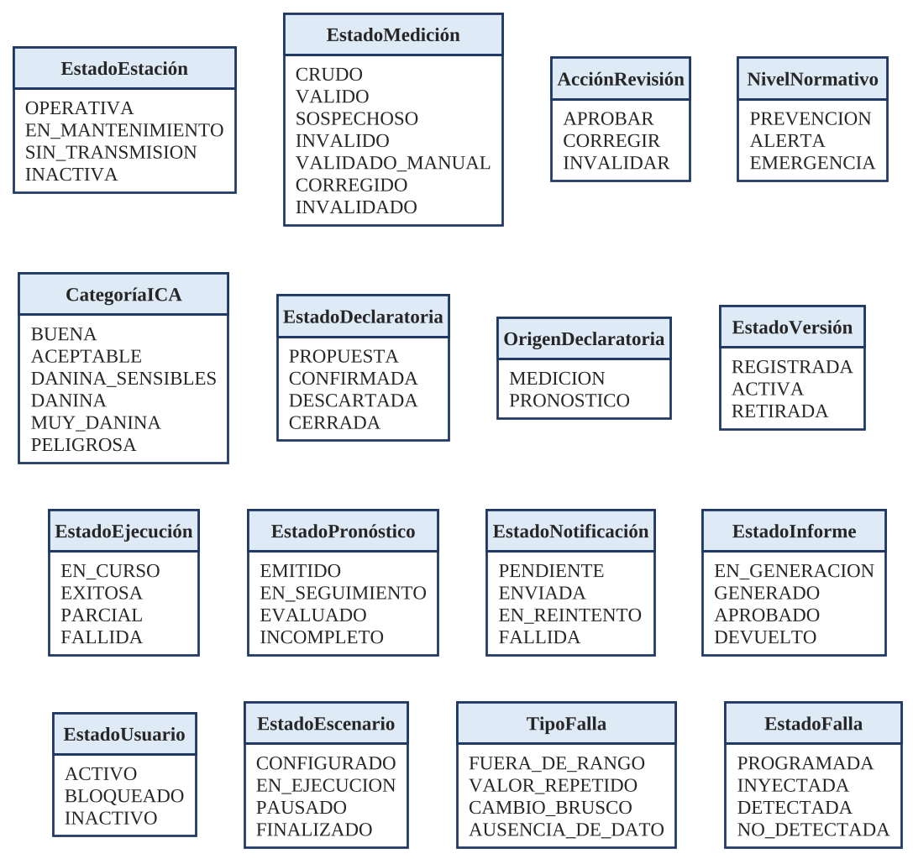

<!-- Generado por tools/docx_a_conocimiento.py desde el .docx. No editar a mano: editar el Word y regenerar. -->

### 3.6.2 Diagramas de clases

El modelo de dominio tiene veintiuna clases organizadas en siete paquetes. La Figura 2 muestra los paquetes y sus dependencias. Red de monitoreo y Seguridad no dependen de ningún otro paquete, Datos depende de ellos, y Normativo, Pronóstico y Difusión se apoyan en Datos. Simulación depende de Red de monitoreo y de Datos, y nada depende de Simulación, así que el simulador puede reemplazarse por una fuente de datos real sin modificar las demás clases. Por legibilidad, el diagrama de clases se presenta en tres figuras por grupos de paquetes. Las clases de otro paquete aparecen sin atributos y con el nombre de su paquete como estereotipo.

**Figura** **2.** *Diagrama de paquetes del modelo de dominio*

Fuente: Elaboración propia.

La Figura 3 reúne la red de monitoreo, los datos y la simulación. Una Estación mide un conjunto de Variables y registra muchas Mediciones. Cada Medición pertenece a una Variable y guarda el valor crudo tal como llegó. Los periodos de mantenimiento de cada estación alimentan una de las reglas de validación automática. Cuando el técnico revisa un dato sospechoso, el sistema crea una Revisión con el valor anterior, el valor nuevo, la justificación y el usuario que la hizo, de modo que el dato crudo nunca se sobrescribe. Un Escenario de Simulación define el periodo reproducido, la velocidad del reloj y las fallas que se inyectan, y cada FallaInyectada se asocia a las Mediciones que alteró. Esa asociación permite medir la precisión y la exhaustividad de las reglas de validación.

**Figura** **3.** *Diagrama de clases de los paquetes Red de monitoreo, Datos y Simulación*

Fuente: Elaboración propia.

La Figura 4 reúne los paquetes normativo y de pronóstico. Las Evaluaciones Normativas se calculan sobre los Promedios Móviles con el Parámetro Normativo vigente y pueden originar una Declaratoria, que también puede proponerse a partir de un Pronóstico. Cada Declaratoria cubre una o varias estaciones y registra quién la confirmó o la descartó. Cada Pronóstico corresponde a una Estación, una Versión de Modelo y una Ejecución del ciclo, y se compone de valores horarios con su intervalo de predicción y el valor observado con el que después se calcula el error.

**Figura** **4.** *Diagrama de clases de los paquetes Normativo y Pronóstico*

Fuente: Elaboración propia.

La Figura 5 reúne la difusión y la seguridad. Las Notificaciones se generan a partir de una Declaratoria confirmada o de un Pronóstico de riesgo, y cada una se envía a un Contacto. Cada Usuario tiene un Rol, genera y aprueba Informes, decide Declaratorias y deja sus acciones en el Registro de Auditoría. Los estados, niveles, categorías y tipos se modelan como enumeraciones, que se presentan en la Figura 6. Los mismos valores se usan en los diagramas de estados y en los tipos enumerados de la base de datos.

**Figura** **5.** *Diagrama de clases de los paquetes Difusión y Seguridad*

Fuente: Elaboración propia.

**Figura** **6.** *Enumeraciones del modelo de dominio*

Fuente: Elaboración propia.
