<!-- Generado por tools/docx_a_conocimiento.py desde el .docx. No editar a mano: editar el Word y regenerar. -->

### 3.6.3 Diagramas de estados

Se modela una máquina de estados para cada clase que cambia de estado durante su vida. Son once clases, y en todas los estados corresponden a los valores de la enumeración que aparece en la Figura 6. Las diez clases restantes no tienen ciclo de vida propio. Son registros inmutables que se crean una vez y no cambian, o catálogos cuya única variación es estar vigentes o no. La Tabla 17 justifica cada caso.

**Tabla** **17.** *Clases sin diagrama de estados*

|                      |                       |                                                                                     |
| -------------------- | --------------------- | ----------------------------------------------------------------------------------- |
| **Clase**            | **Tipo**              | **Justificación**                                                                   |
| Variable             | Catálogo              | Se configura una vez. Sus cambios se registran en la auditoría sin cambio de estado |
| PeriodoMantenimiento | Registro inmutable    | Describe un intervalo pasado o programado y se consulta por fecha                   |
| Revisión             | Registro inmutable    | Documenta una decisión del técnico y nunca se edita                                 |
| PromedioMóvil        | Valor calculado       | Se recalcula cuando cambia un dato, sin estados intermedios                         |
| ParámetroNormativo   | Catálogo con vigencia | Su vigencia se resuelve con las fechas de inicio y fin                              |
| EvaluaciónNormativa  | Registro inmutable    | Guarda el resultado de una evaluación horaria                                       |
| ValorPronosticado    | Valor calculado       | Su único cambio es recibir el valor observado                                       |
| Contacto             | Catálogo              | Solo se activa o desactiva con un atributo booleano                                 |
| Rol                  | Catálogo              | Agrupa permisos y no tiene ciclo de vida                                            |
| RegistroAuditoría    | Registro inmutable    | Se escribe una vez y no admite cambios (RNF-18)                                     |

Fuente: Elaboración propia.

La Figura 7 describe el ciclo de vida de una medición. Toda medición entra al sistema en CRUDO, y la validación automática la deja en VÁLIDO, SOSPECHOSO o INVÁLIDO según las reglas que aplique. Las mediciones en SOSPECHOSO pasan a la cola de revisión, donde el técnico las aprueba, las corrige o las invalida. Cada decisión crea una Revisión y lleva la medición a VALIDADO\_MANUAL, CORREGIDO o INVALIDADO. El valor crudo no se modifica en ningún estado, y cuando el dato se corrige el valor nuevo queda en la Revisión. Solo VÁLIDO, VALIDADO\_MANUAL y CORREGIDO habilitan el dato para el cálculo de promedios, así que cada revisión obliga a recalcular los promedios afectados.

**Figura** **7.** *Diagrama de estados de la clase Medición*

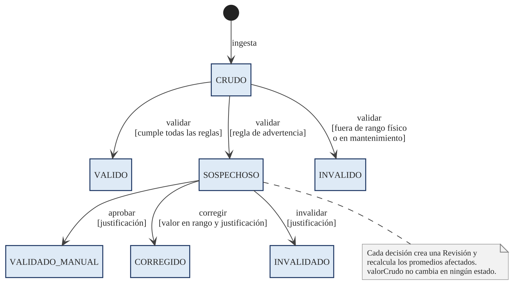

Fuente: Elaboración propia.

La Figura 8 describe la declaratoria. Empieza como PROPUESTA cuando una evaluación normativa o un pronóstico supera el umbral. Si el coordinador la confirma con soporte técnico, pasa a CONFIRMADA y el sistema notifica a los contactos. Si la descarta con una justificación, queda en DESCARTADA y no se notifica a nadie. Mientras está confirmada, un aumento del nivel actualiza la declaratoria y genera una nueva notificación. Pasa a CERRADA cuando la evaluación horaria indica que las condiciones que la originaron dejaron de cumplirse.

**Figura** **8.** *Diagrama de estados de la clase Declaratoria*

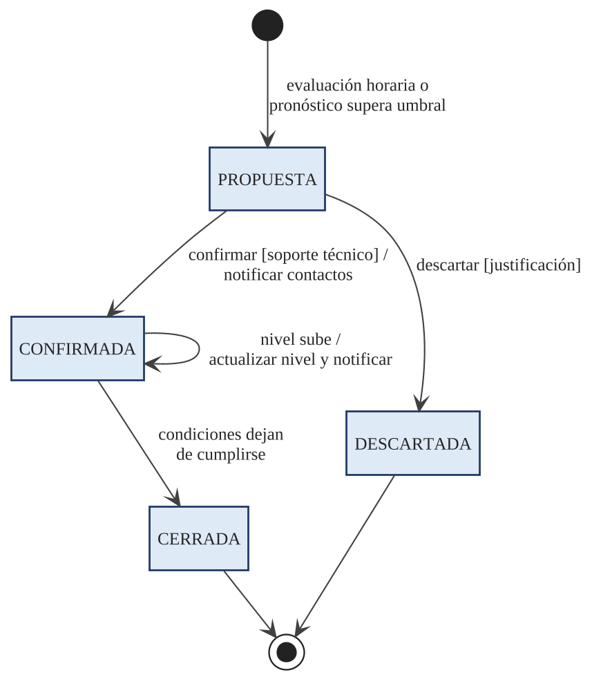

Fuente: Elaboración propia.

La Figura 9 muestra los estados de una estación. Una estación registrada queda OPERATIVA. Pasa a EN\_MANTENIMIENTO durante un periodo de mantenimiento y vuelve al terminar. Si no llega ningún dato durante más de dos horas, el proceso de detección de ausencias la deja en SIN\_TRANSMISION y alerta al técnico (RNF-03), y la primera medición nueva la devuelve a OPERATIVA. El administrador puede darla de baja, con lo que queda INACTIVA, y reactivarla después.

**Figura** **9.** *Diagrama de estados de la clase Estación*

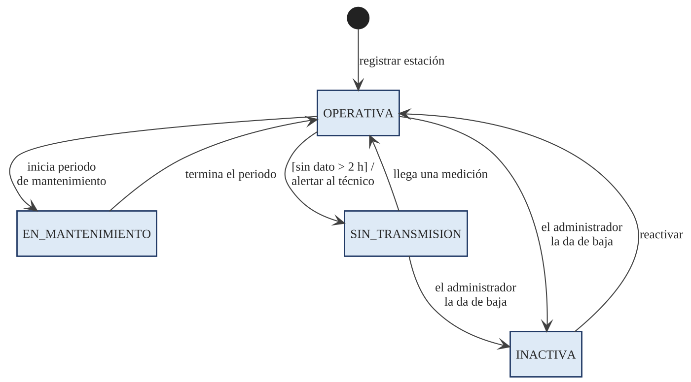

Fuente: Elaboración propia.

La Figura 10 sigue un pronóstico desde su emisión. Se guarda como EMITIDO junto con la versión del modelo y la ejecución que lo produjo. Con el primer valor observado pasa a EN\_SEGUIMIENTO, y cada nuevo valor calcula el error de esa hora. Al vencer el horizonte de 24 horas queda EVALUADO si todas las horas tienen observación, o INCOMPLETO si hay menos de 18, que es el mismo criterio de 75 % que se aplica a los promedios.

**Figura** **10.** *Diagrama de estados de la clase Pronóstico*

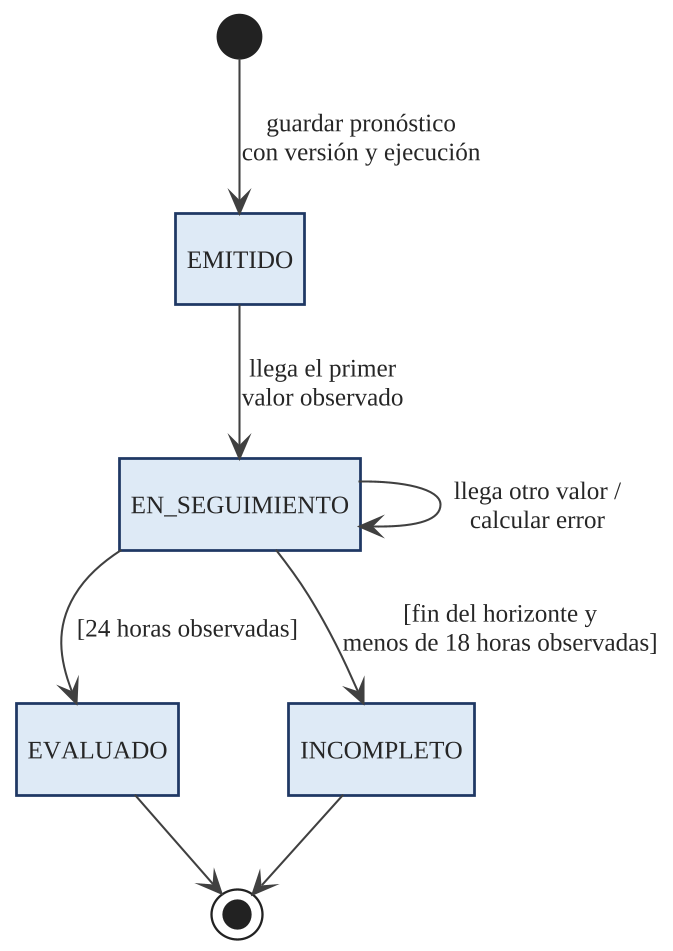

Fuente: Elaboración propia.

La Figura 11 muestra cómo se gestiona el modelo. Cada versión entrenada se registra con sus métricas de validación. Solo se activa si su MAE es menor que el de las líneas base, y al activar una versión la anterior pasa a RETIRADA. El índice único de la base de datos impide que haya dos versiones activas a la vez.

**Figura** **11.** *Diagrama de estados de la clase VersiónModelo*

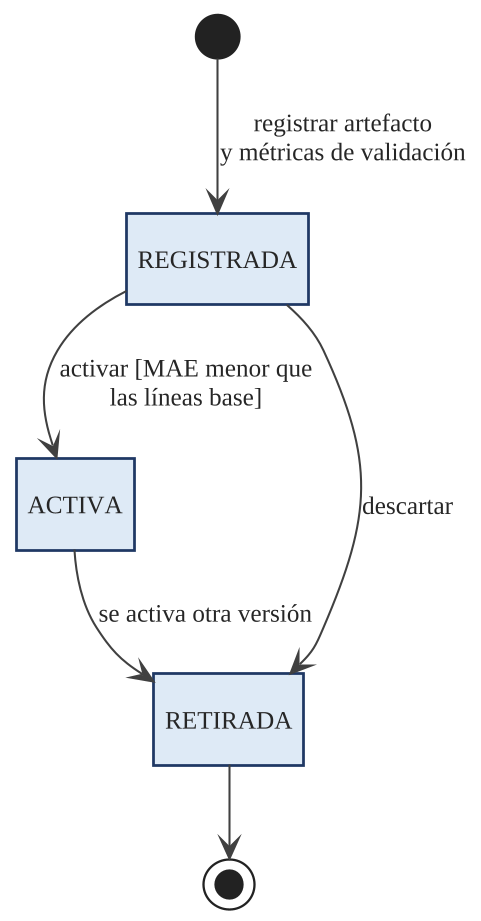

Fuente: Elaboración propia.

La Figura 12 describe una ejecución del ciclo diario. El planificador la abre EN\_CURSO. Termina EXITOSA si todas las estaciones reciben pronóstico, PARCIAL si alguna se omitió por falta de datos y FALLIDA si el modelo produce un error, caso en el que el mensaje queda registrado (RNF-06).

**Figura** **12.** *Diagrama de estados de la clase EjecuciónCiclo*

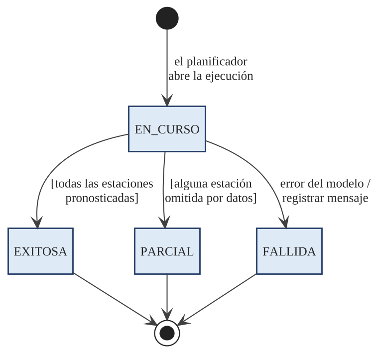

Fuente: Elaboración propia.

La Figura 13 muestra el envío de una notificación. Se crea PENDIENTE para cada contacto activo. Si el servidor de correo acepta el mensaje queda ENVIADA. Si falla pasa a EN\_REINTENTO y se vuelve a intentar hasta tres veces. Al tercer error queda FALLIDA y se alerta al administrador.

**Figura** **13.** *Diagrama de estados de la clase Notificación*

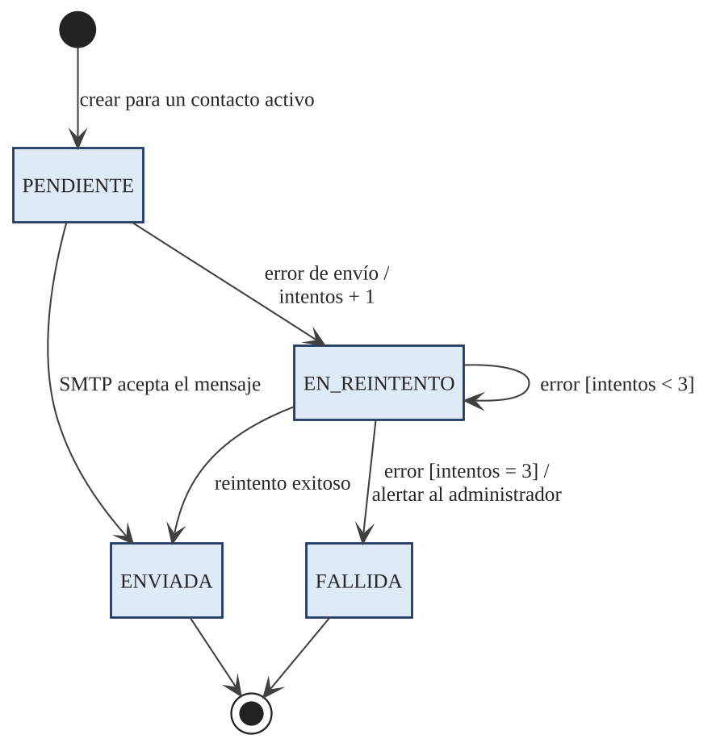

Fuente: Elaboración propia.

La Figura 14 sigue el informe mensual. Está EN\_GENERACION mientras se consultan los datos validados y se compone el PDF, y pasa a GENERADO cuando el archivo existe. El coordinador lo aprueba, con lo que queda APROBADO, o lo devuelve con observaciones. Un informe DEVUELTO se regenera después de revisar los datos.

**Figura** **14.** *Diagrama de estados de la clase Informe*

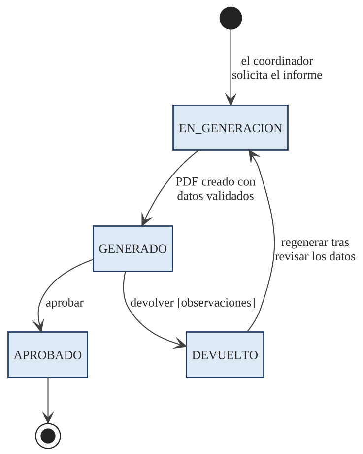

Fuente: Elaboración propia.

La Figura 15 muestra los estados de una cuenta. Toda cuenta nueva está ACTIVA. Cada inicio de sesión fallido suma un intento y al quinto la cuenta queda BLOQUEADA hasta que el administrador la desbloquee (RNF-17). El administrador también puede desactivar una cuenta y reactivarla después.

**Figura** **15.** *Diagrama de estados de la clase Usuario*

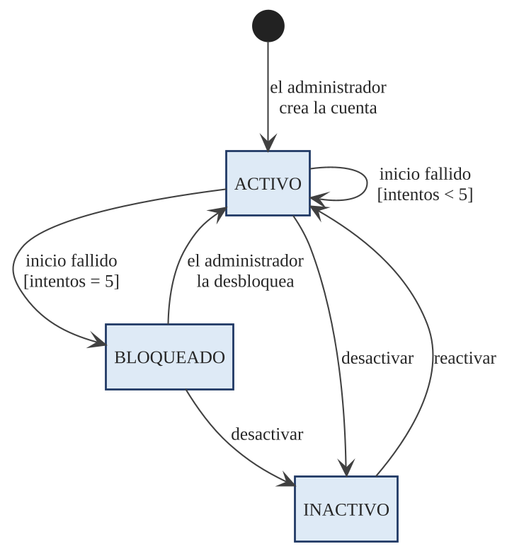

Fuente: Elaboración propia.

La Figura 16 describe un escenario de simulación. Se crea CONFIGURADO con el periodo, la velocidad del reloj y las fallas. Al iniciarlo pasa a EN\_EJECUCION y puede pausarse y reanudarse. Termina FINALIZADO cuando el reloj virtual alcanza el fin del periodo o cuando el administrador lo detiene.

**Figura** **16.** *Diagrama de estados de la clase EscenarioSimulación*

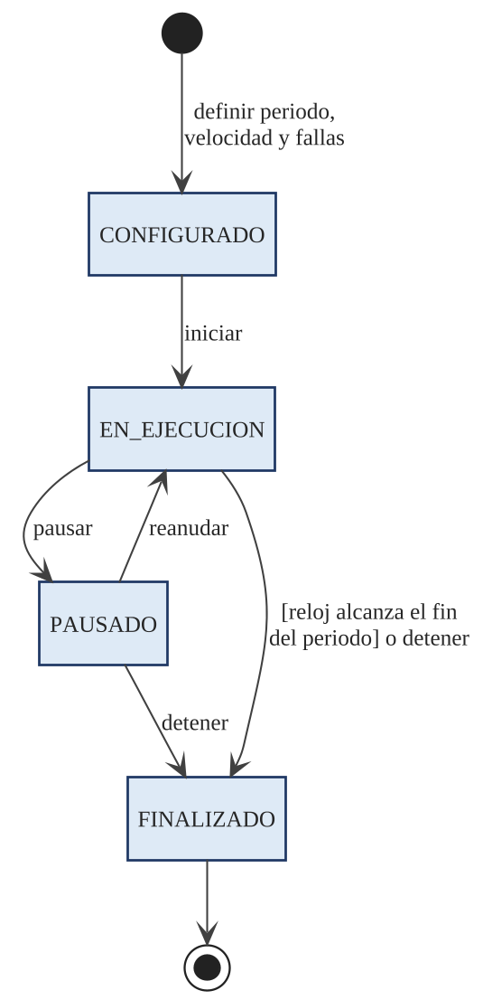

Fuente: Elaboración propia.

La Figura 17 muestra el ciclo de una falla inyectada, que es la base para medir las reglas de validación. La falla queda PROGRAMADA al configurar el escenario y pasa a INYECTADA cuando el reloj llega a su inicio y el simulador altera las mediciones. Al terminar queda DETECTADA si alguna medición alterada fue marcada como SOSPECHOSO o INVALIDO, y NO\_DETECTADA en caso contrario.

**Figura** **17.** *Diagrama de estados de la clase FallaInyectada*

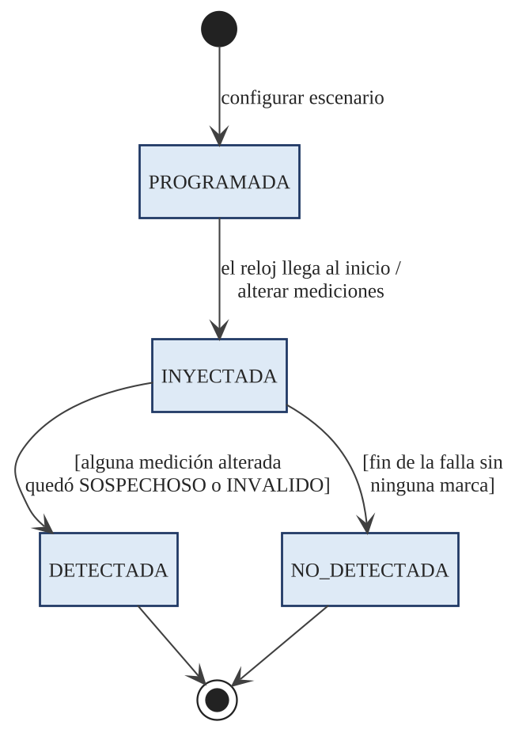

Fuente: Elaboración propia.
