<!-- Generado por tools/docx_a_conocimiento.py desde el .docx. No editar a mano: editar el Word y regenerar. -->

### 3.6.4 Diagramas de Colaboración

Los diagramas de colaboración, también llamados de comunicación, muestran los objetos que intervienen en cada proceso de la Tabla 14 y los mensajes numerados que se envían. El número indica el orden, un número compuesto como 3.1 indica un mensaje anidado y el asterisco indica repetición. Las condiciones van entre corchetes y las flechas punteadas son respuestas. Hay un diagrama por proceso, del P-01 al P-12.

En el proceso P-01 de la Figura 18, el simulador consulta la hora al servicio de reloj, pide al escenario las fallas activas y lee del archivo histórico las mediciones de la última hora. Aplica cada falla, la marca como inyectada y envía el lote a la interfaz de ingesta. Cuando el reloj alcanza el fin del periodo, finaliza el escenario.

**Figura** **18.** *Diagrama de colaboración del proceso P-01 Reproducción de mediciones*

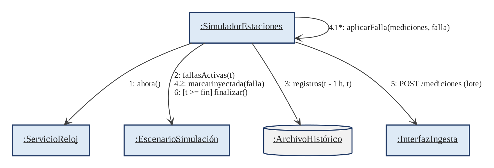

Fuente: Elaboración propia.

En la ingesta de la Figura 19, la interfaz verifica que el lote cumpla el contrato. Si es válido, el servicio guarda cada medición en estado CRUDO y cuenta las duplicadas que rechaza la restricción de unicidad. Luego solicita la validación y la interfaz responde al simulador con el resumen del lote.

**Figura** **19.** *Diagrama de colaboración del proceso P-02 Ingesta*

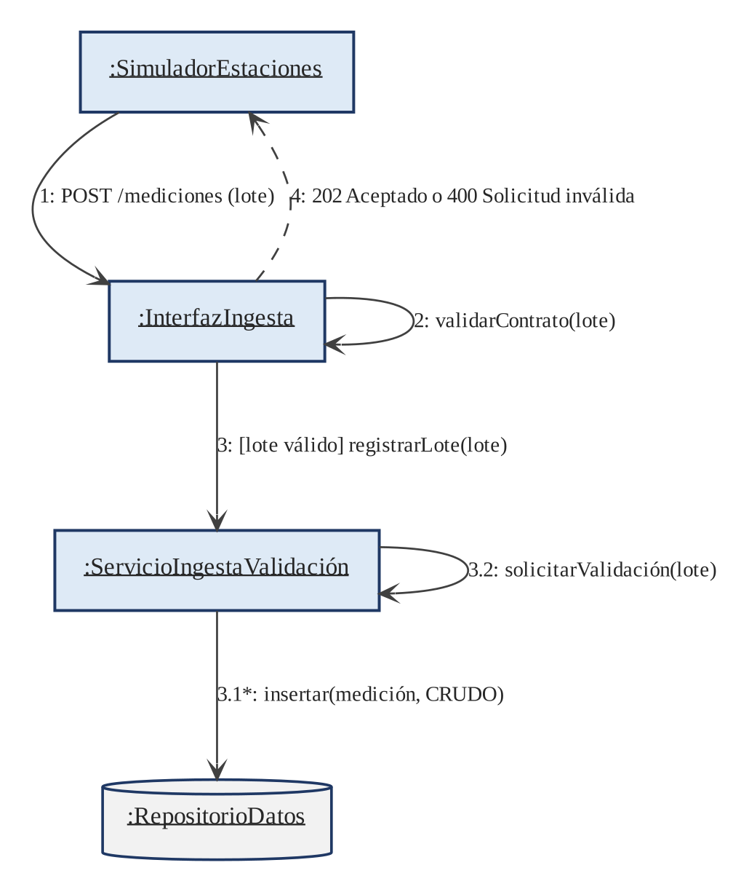

Fuente: Elaboración propia.

En la Figura 20, el validador carga el contexto de cada serie, aplica las reglas a cada medición y actualiza su estado. Las mediciones marcadas como SOSPECHOSO pasan a la cola de revisión. Al terminar, el validador pide al servicio normativo que recalcule los promedios de las estaciones y horas afectadas.

**Figura** **20.** *Diagrama de colaboración del proceso P-03 Validación automática*

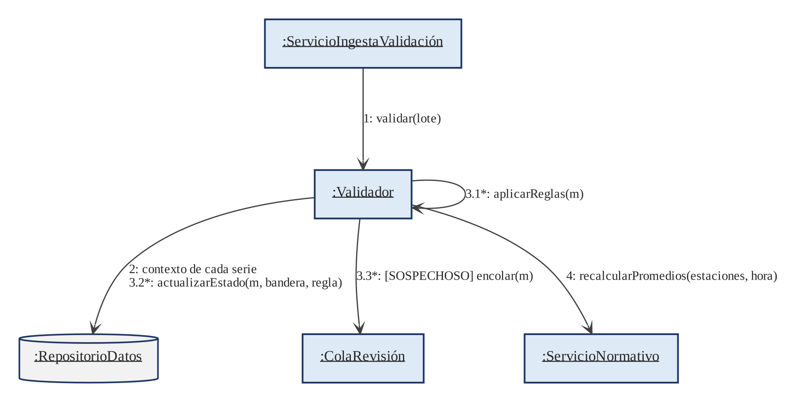

Fuente: Elaboración propia.

En la Figura 21, el planificador consulta la hora y pide la detección de ausencias. El servicio de ingesta consulta la última medición de cada estación, cambia a SIN\_TRANSMISION las que llevan más de dos horas sin datos, registra las horas faltantes y publica la alerta en la interfaz web. Las estaciones que vuelven a transmitir regresan a OPERATIVA.

**Figura** **21.** *Diagrama de colaboración del proceso P-04 Detección de ausencia*

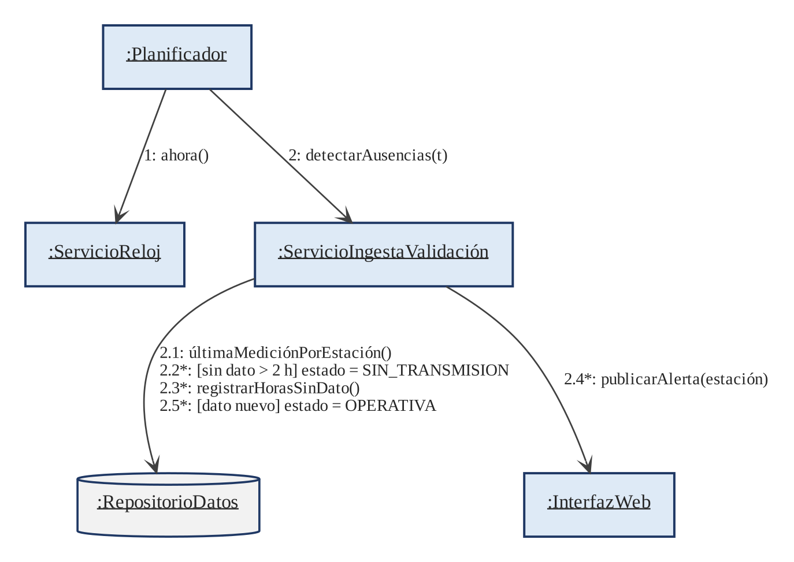

Fuente: Elaboración propia.

La Figura 22 corresponde a la revisión manual del CU-03. El técnico abre la cola, elige un dato y una acción, ingresa el valor nuevo si corrige y confirma con una justificación. El servicio guarda la Revisión, actualiza el estado de la medición, registra la auditoría y solicita el recálculo de los promedios.

**Figura** **22.** *Diagrama de colaboración del proceso P-05 Revisión manual*

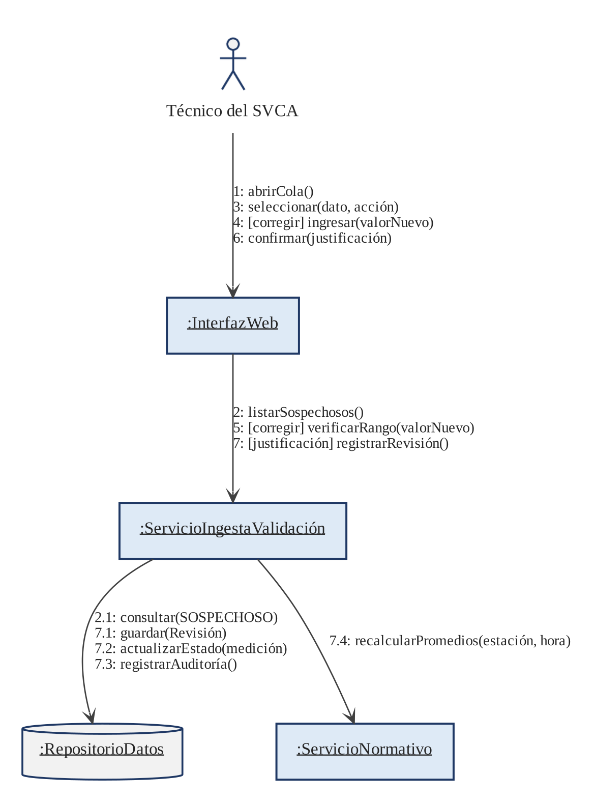

Fuente: Elaboración propia.

En la agregación de la Figura 23, el servicio normativo obtiene para cada estación y variable los valores válidos de las últimas 24 horas, calcula el promedio móvil y marca como representativo el que tiene al menos 18 horas válidas, que equivalen al 75 % exigido por el protocolo.

**Figura** **23.** *Diagrama de colaboración del proceso P-06 Agregación*

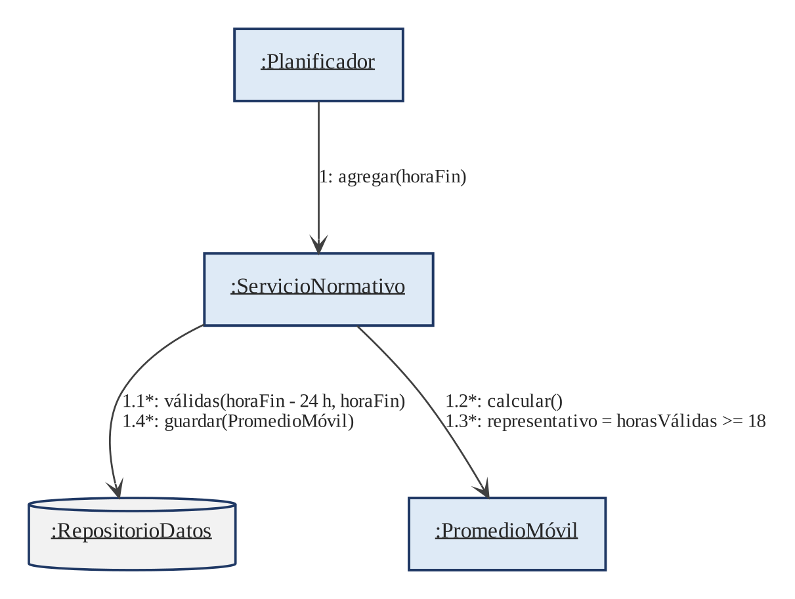

Fuente: Elaboración propia.

En la Figura 24, el servicio normativo toma el parámetro vigente y evalúa los promedios. Si el nivel alcanza prevención y no hay una declaratoria abierta, crea una en estado PROPUESTA y avisa al coordinador. Si una declaratoria confirmada ya no cumple las condiciones, la cierra.

**Figura** **24.** *Diagrama de colaboración del proceso P-07 Evaluación normativa*

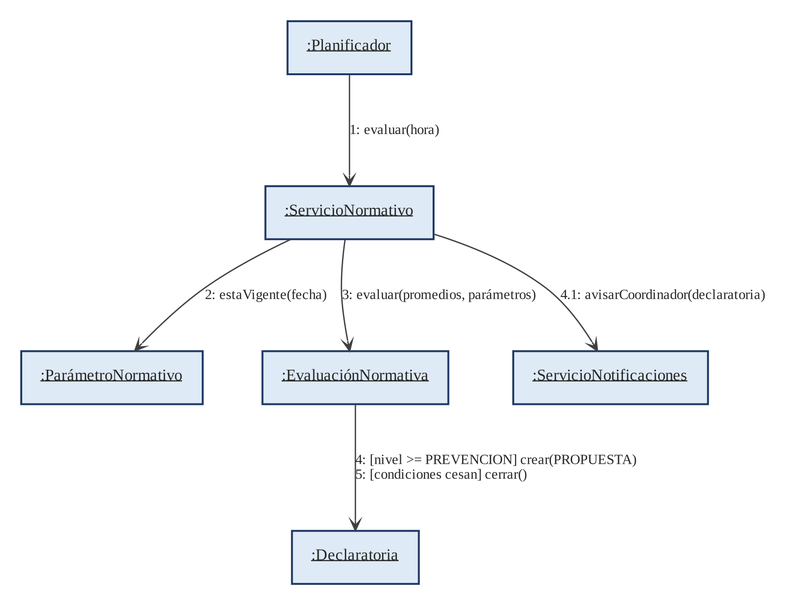

Fuente: Elaboración propia.

La Figura 25 corresponde al pronóstico diario del CU-07. El planificador abre la ejecución y llama al servicio de pronóstico, que carga la versión activa, obtiene para cada estación los datos anteriores al momento de emisión (RNF-02) y guarda el pronóstico. Si el valor supera el umbral, propone una declaratoria. Al final el planificador cierra la ejecución con su resultado.

**Figura** **25.** *Diagrama de colaboración del proceso P-08 Pronóstico*

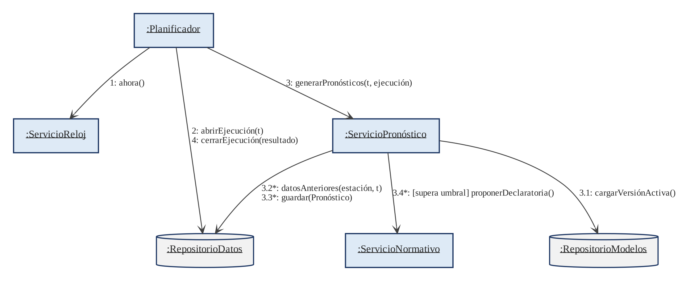

Fuente: Elaboración propia.

En la Figura 26, el servicio de pronóstico registra el valor observado en cada valor pronosticado de la hora, calcula su error, actualiza el estado de los pronósticos y recalcula el MAE y el RMSE de la versión activa. Esos valores alimentan el tablero de desempeño del CU-08.

**Figura** **26.** *Diagrama de colaboración del proceso P-09 Seguimiento del pronóstico*

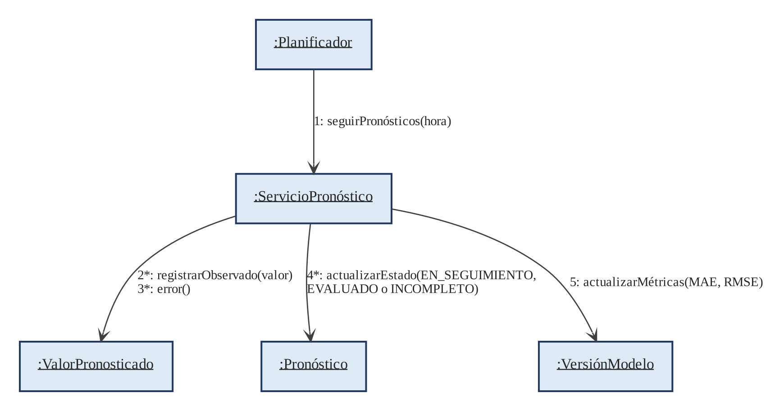

Fuente: Elaboración propia.

En la Figura 27, el servicio de notificaciones recibe la declaratoria confirmada o el pronóstico de riesgo, obtiene los contactos activos, crea una notificación por contacto y la envía al servidor de correo. El estado de cada notificación queda en ENVIADA, EN\_REINTENTO o FALLIDA.

**Figura** **27.** *Diagrama de colaboración del proceso P-10 Notificación*

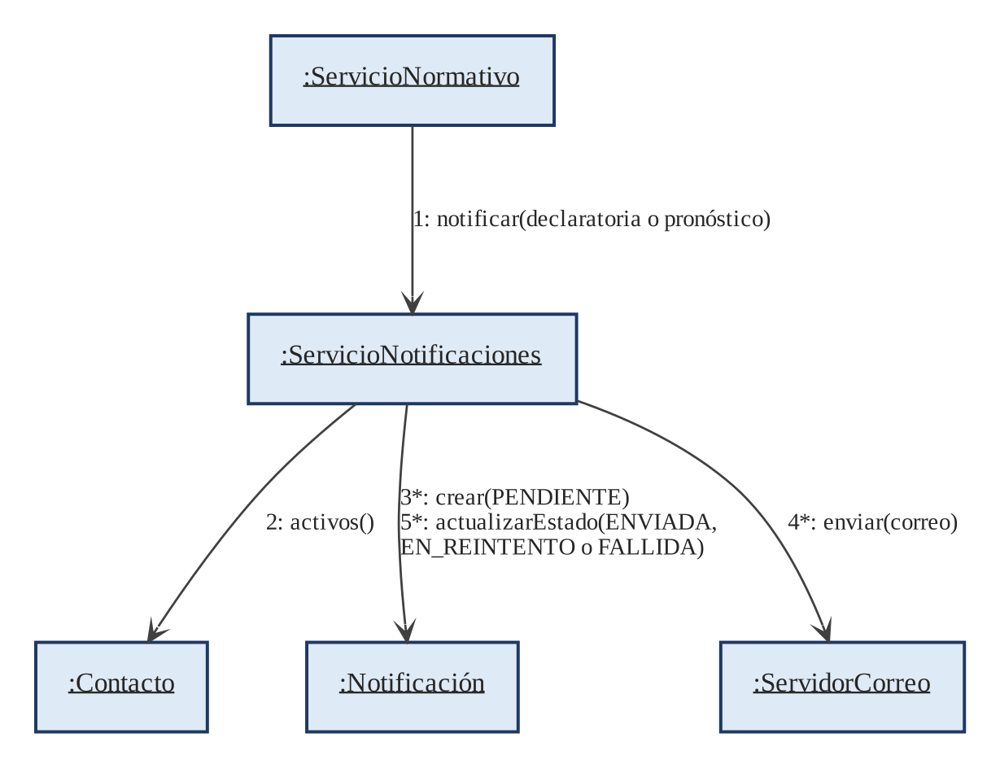

Fuente: Elaboración propia.

En la Figura 28, el coordinador solicita el informe desde la interfaz web. El servicio de informes, que forma parte del servicio de notificaciones e informes, consulta los datos validados del periodo, genera el PDF y lo guarda. Después el coordinador lo aprueba o lo devuelve con observaciones.

**Figura** **28.** *Diagrama de colaboración del proceso P-11 Informe mensual*

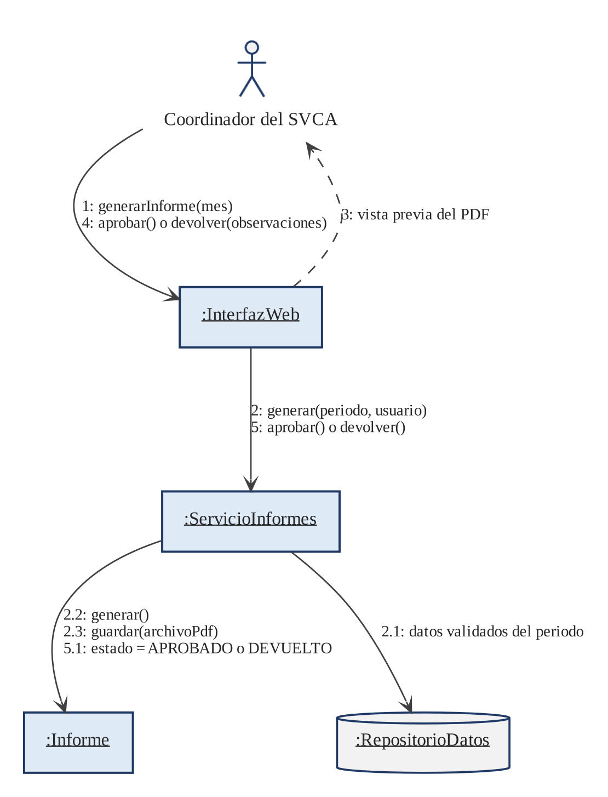

Fuente: Elaboración propia.

En la Figura 29, el técnico solicita la exportación de un periodo y unas estaciones. El servicio consulta la vista de datos válidos, da formato al archivo según el formato de carga y registra la exportación en la auditoría antes de entregar la descarga.

**Figura** **29.** *Diagrama de colaboración del proceso P-12 Exportación*

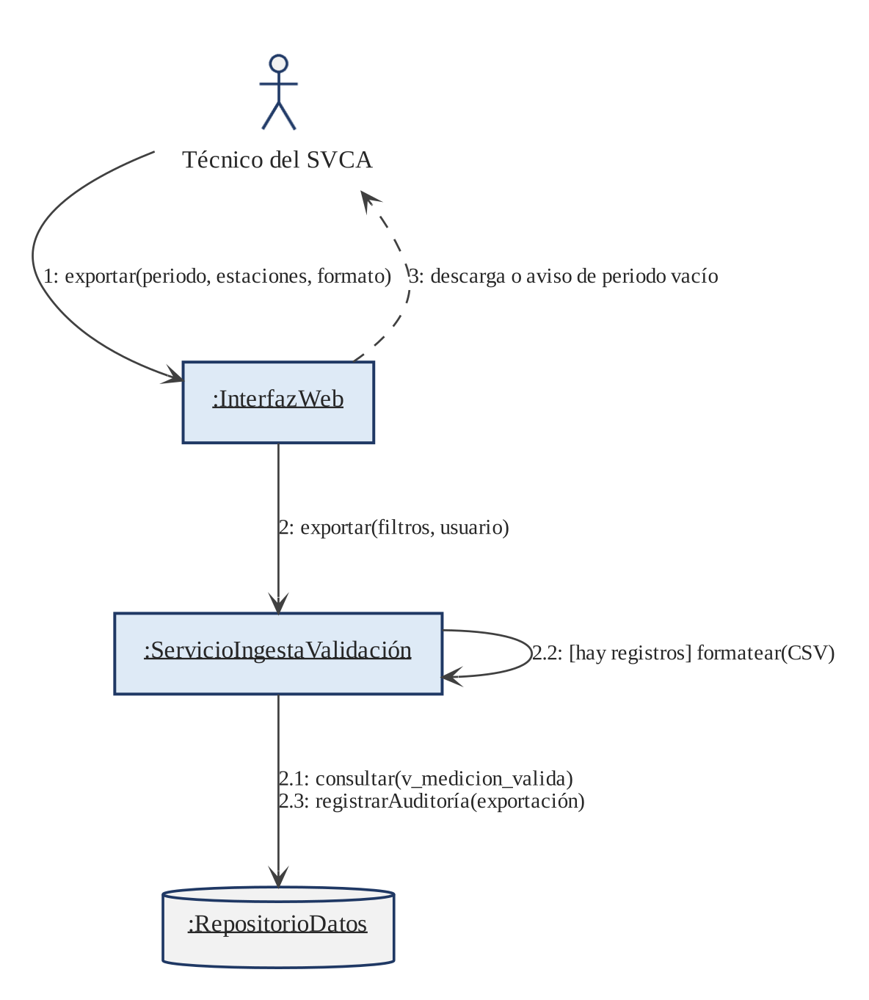

Fuente: Elaboración propia.
