<!-- Generado por tools/docx_a_conocimiento.py desde el .docx. No editar a mano: editar el Word y regenerar. -->

### 3.6.5 Diagramas de Secuencia

Los diagramas de secuencia muestran los mismos doce procesos en el tiempo. Cada uno incluye las barras de activación y los fragmentos combinados alt para alternativas, opt para pasos opcionales y loop para repeticiones. Las condiciones de cada fragmento coinciden con los flujos alternos de los casos de uso.

La Figura 30 detalla la reproducción. El bucle aplica una a una las fallas activas antes del envío, y el fragmento opcional final cierra el escenario cuando el reloj alcanza el fin del periodo.

**Figura** **30.** *Diagrama de secuencia del proceso P-01 Reproducción de mediciones*

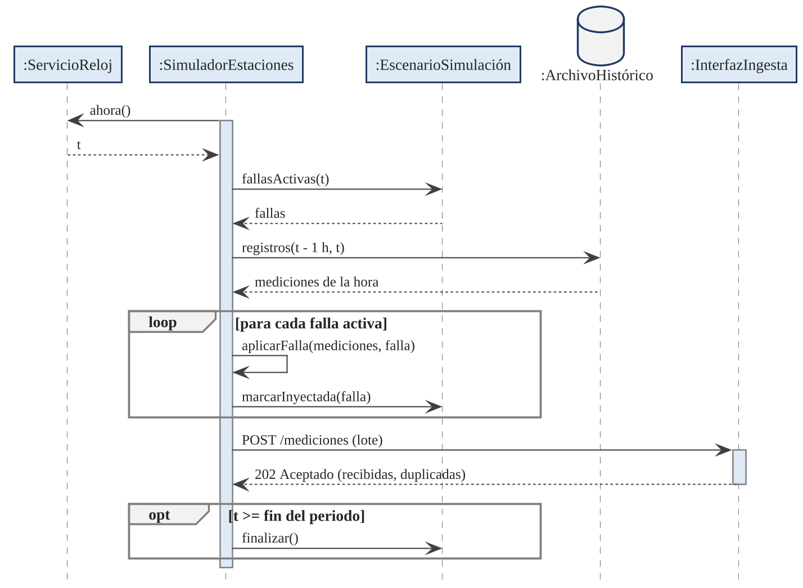

Fuente: Elaboración propia.

En la Figura 31, el fragmento alternativo separa el lote mal formado, que recibe una respuesta 400, del lote válido. Dentro del bucle de inserción, un segundo fragmento cuenta las mediciones duplicadas sin detener el lote.

**Figura** **31.** *Diagrama de secuencia del proceso P-02 Ingesta*

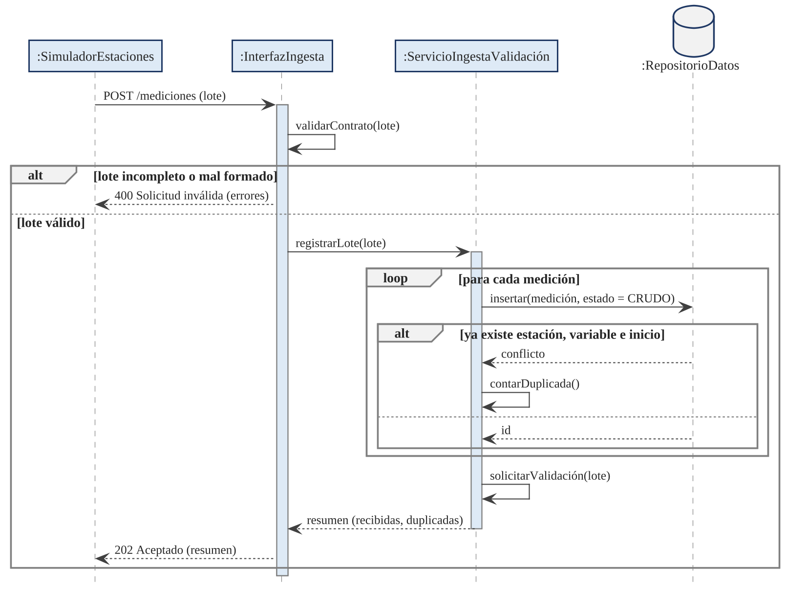

Fuente: Elaboración propia.

La Figura 32 muestra el orden de las reglas, que es rango físico, mantenimiento, valor repetido durante seis horas, cambio brusco y comparación entre estaciones. El fragmento alternativo asigna la bandera según el tipo de regla que falla.

**Figura** **32.** *Diagrama de secuencia del proceso P-03 Validación automática*

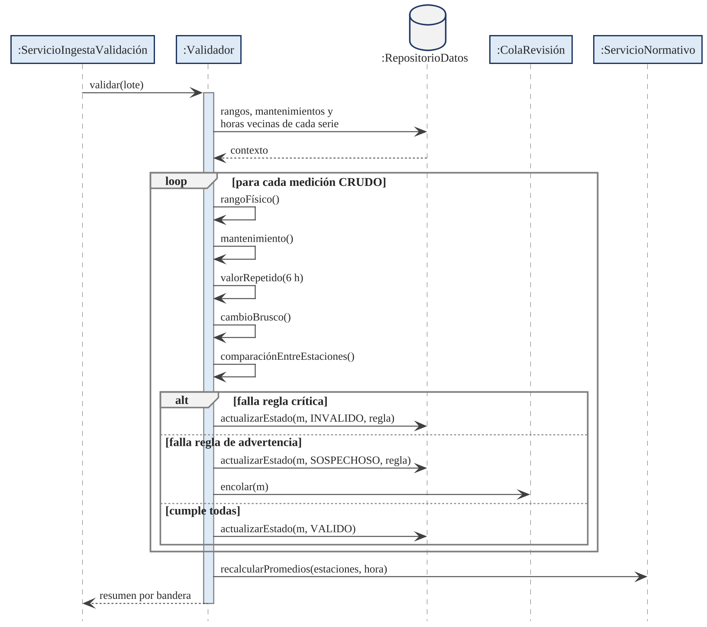

Fuente: Elaboración propia.

La Figura 33 tiene dos bucles. El primero marca las estaciones sin transmisión y el segundo devuelve a OPERATIVA las que recuperaron la señal.

**Figura** **33.** *Diagrama de secuencia del proceso P-04 Detección de ausencia*

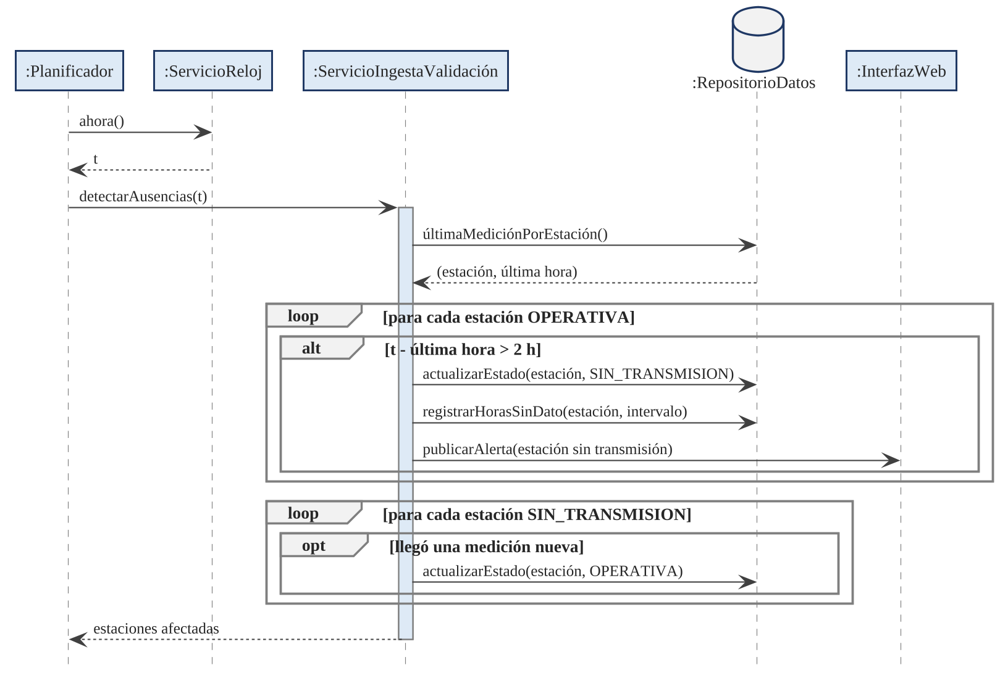

Fuente: Elaboración propia.

La Figura 34 corresponde al CU-03. El fragmento opcional cubre el flujo 4a, en el que el valor corregido se verifica contra el rango físico, y el fragmento alternativo cubre el flujo 6a, en el que una justificación vacía impide confirmar.

**Figura** **34.** *Diagrama de secuencia del proceso P-05 Revisión manual*

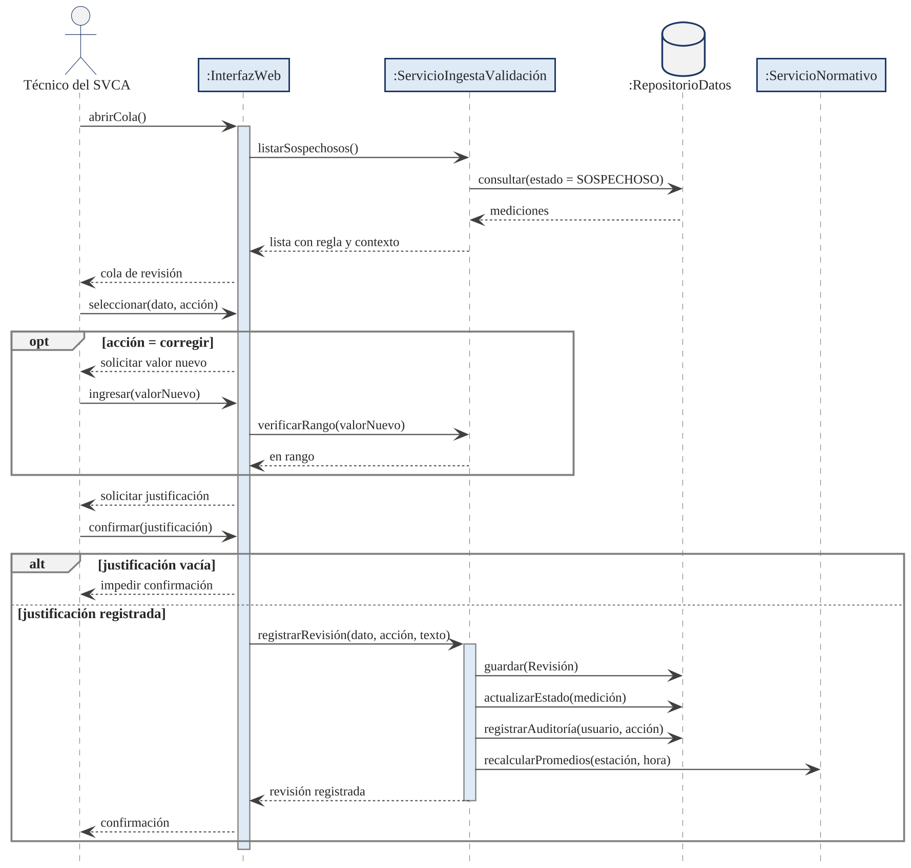

Fuente: Elaboración propia.

La Figura 35 repite el cálculo para cada estación y variable. La representatividad es una columna calculada de la base de datos, así que no depende del código del servicio.

**Figura** **35.** *Diagrama de secuencia del proceso P-06 Agregación*

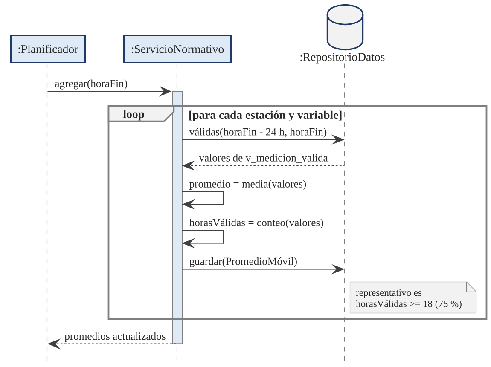

Fuente: Elaboración propia.

En la Figura 36, el fragmento alternativo distingue entre abrir una propuesta de declaratoria y cerrar una declaratoria confirmada cuyas condiciones cesaron.

**Figura** **36.** *Diagrama de secuencia del proceso P-07 Evaluación normativa*

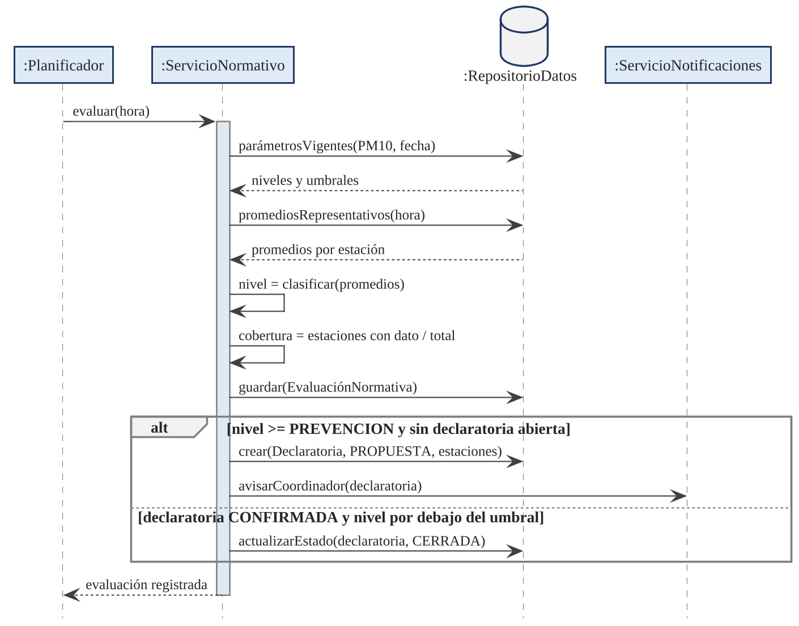

Fuente: Elaboración propia.

La Figura 37 corresponde al CU-07. Dentro del bucle por estación, el fragmento alternativo cubre los flujos 2a y 3a, que son datos insuficientes y error del modelo, y el fragmento opcional crea la propuesta de declaratoria cuando el pronóstico supera el umbral.

**Figura** **37.** *Diagrama de secuencia del proceso P-08 Pronóstico*

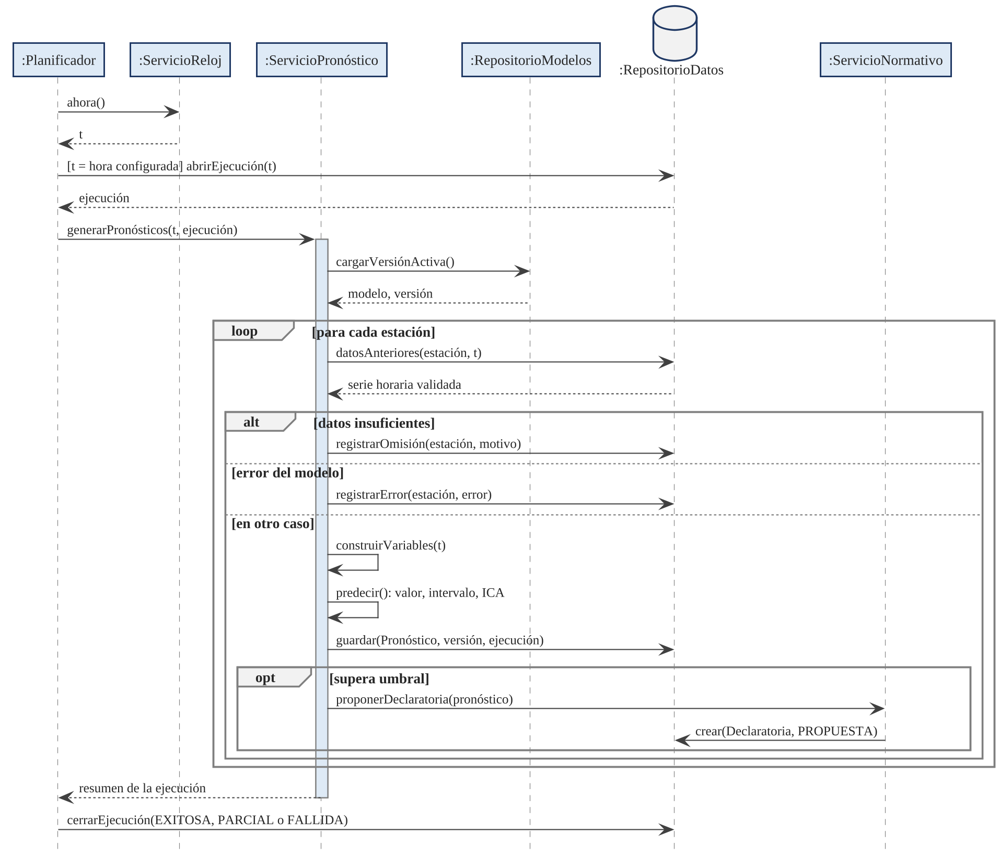

Fuente: Elaboración propia.

La Figura 38 registra los valores observados de la hora y, para los pronósticos cuyo horizonte venció, decide entre EVALUADO e INCOMPLETO antes de actualizar las métricas de la versión activa.

**Figura** **38.** *Diagrama de secuencia del proceso P-09 Seguimiento del pronóstico*

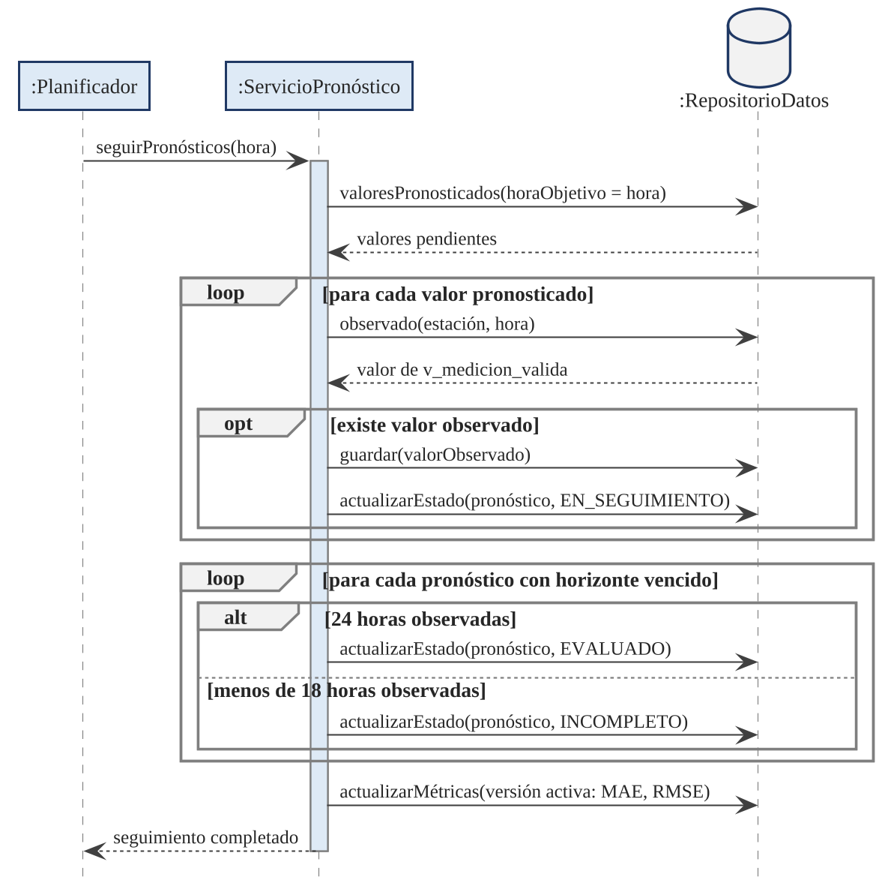

Fuente: Elaboración propia.

En la Figura 39, el bucle recorre los contactos activos. El fragmento alternativo maneja la respuesta del servidor de correo, y el opcional deja la notificación en FALLIDA al tercer intento.

**Figura** **39.** *Diagrama de secuencia del proceso P-10 Notificación*

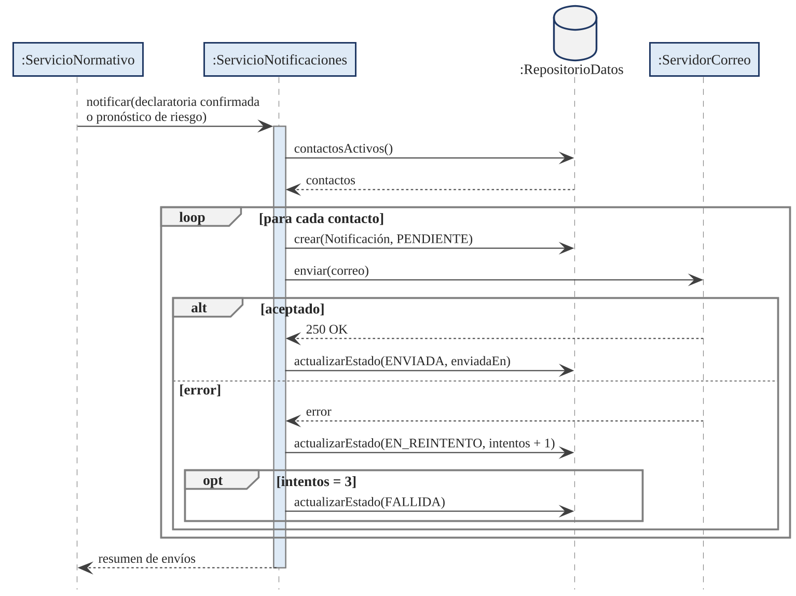

Fuente: Elaboración propia.

La Figura 40 muestra la generación del informe y la decisión del coordinador, con un fragmento alternativo para aprobar o devolver.

**Figura** **40.** *Diagrama de secuencia del proceso P-11 Informe mensual*

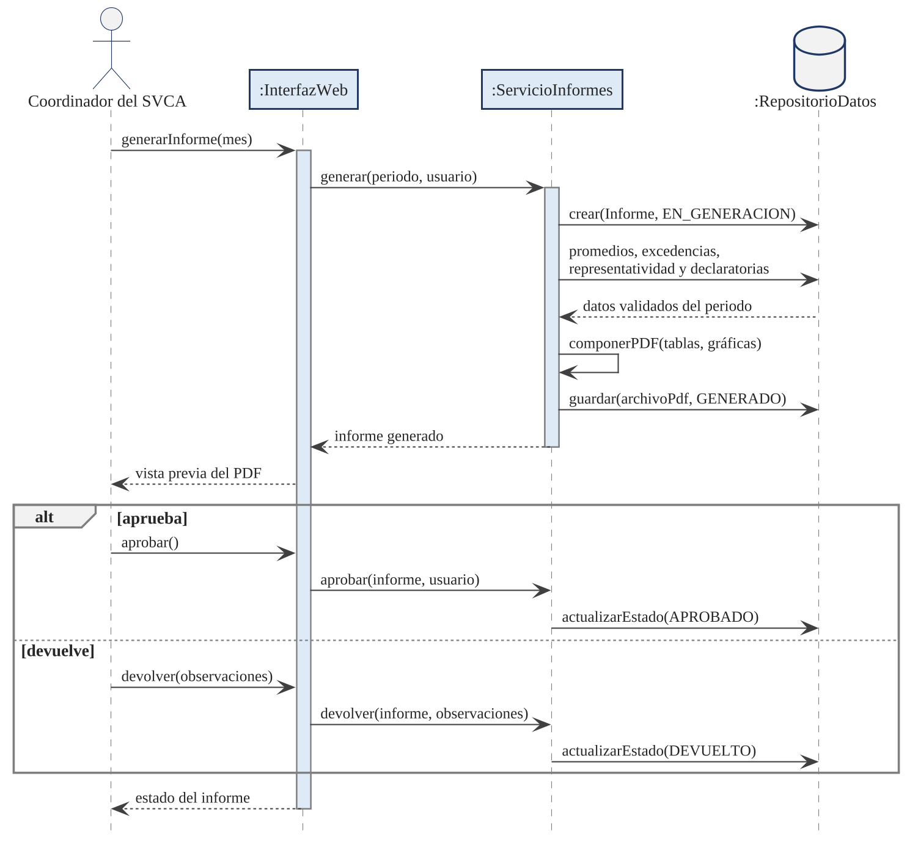

Fuente: Elaboración propia.

La Figura 41 cubre la exportación. Si el periodo no tiene registros validados, el sistema avisa en lugar de entregar un archivo vacío.

**Figura** **41.** *Diagrama de secuencia del proceso P-12 Exportación*

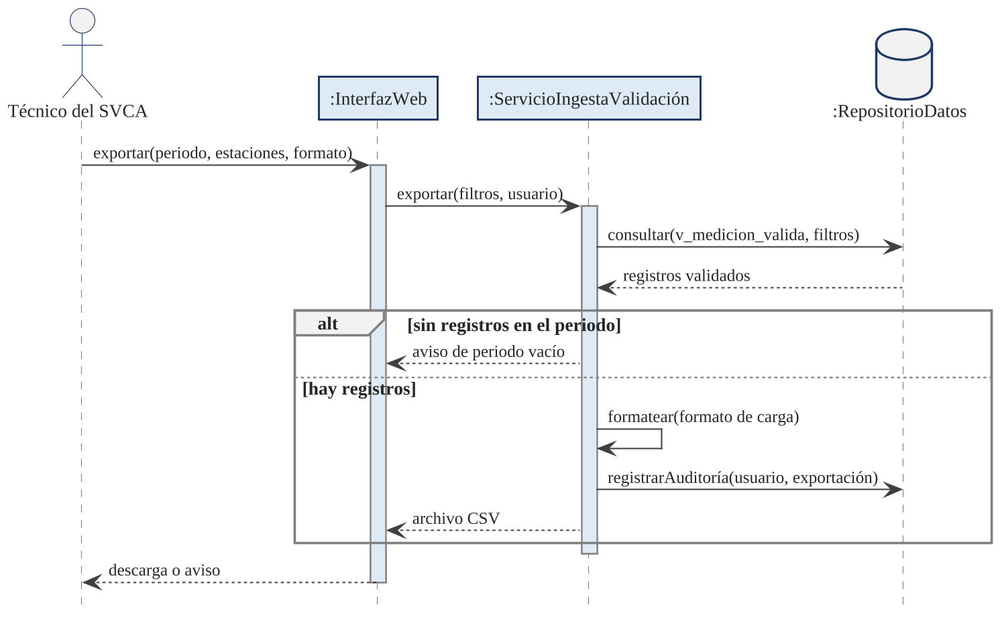

Fuente: Elaboración propia.
