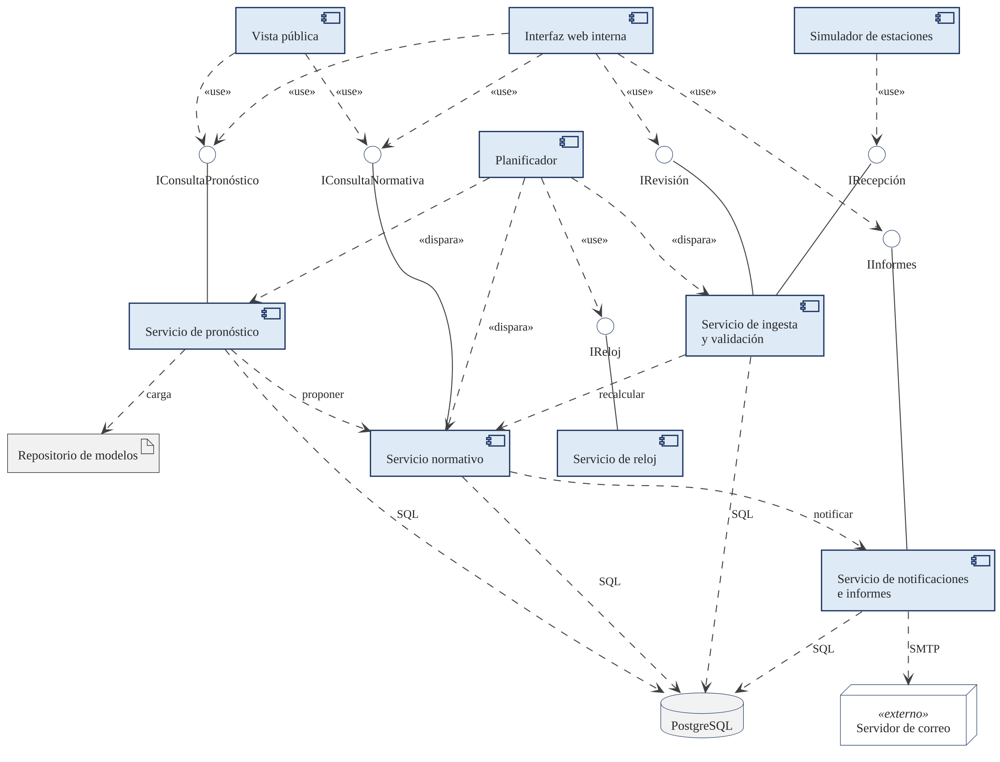

<!-- Generado por tools/docx_a_conocimiento.py desde el .docx. No editar a mano: editar el Word y regenerar. -->

### 3.6.6 Diagramas de Componentes

La arquitectura se divide en servicios. Cada uno tiene una responsabilidad acotada y una interfaz de programación documentada con OpenAPI (RNF-09).

El simulador de estaciones es el adaptador de entrada. Reproduce los datos históricos e inyecta las fallas configuradas, y como solo depende de la interfaz de recepción, puede reemplazarse por una fuente de datos real sin cambiar los demás servicios (RNF-04). El servicio de ingesta y validación expone esa interfaz, aplica las reglas de calidad del dato y mantiene la cola de revisión. El servicio normativo calcula los promedios móviles, la representatividad y los niveles, y crea las propuestas de declaratoria. El servicio de pronóstico carga la versión activa del modelo desde el repositorio de modelos y emite los pronósticos. El servicio de notificaciones e informes envía los correos a los contactos y genera los informes en PDF.

Un planificador común dispara los procesos periódicos. Todos los servicios toman la hora del servicio de reloj, así que el reloj virtual de la reproducción rige igual para todo el sistema. La interfaz web de los usuarios internos y la vista pública consumen las interfaces de programación, y en esas interfaces se aplican la autenticación y el control por roles (RNF-05). Los datos se guardan en una base de datos PostgreSQL. La Figura 42 presenta el diagrama.

**Figura** **42.** *Diagrama de componentes*

Fuente: Elaboración propia.
