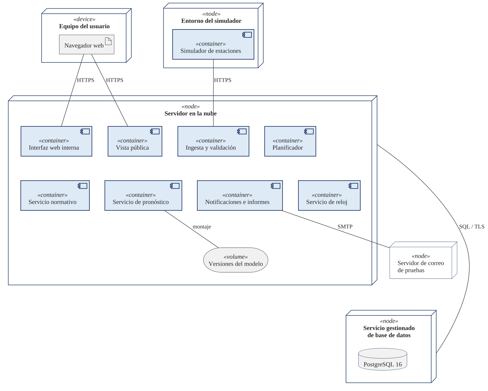

<!-- Generado por tools/docx_a_conocimiento.py desde el .docx. No editar a mano: editar el Word y regenerar. -->

### 3.6.7 Diagramas de Distribución

El diagrama de distribución muestra los nodos donde se ejecuta el sistema y cómo se comunican. Los usuarios internos y los ciudadanos entran desde el navegador, por HTTPS, a un servidor en la nube. En ese servidor corren en contenedores la interfaz web, la vista pública, los cuatro servicios de la Figura 42, el planificador y el servicio de reloj (RNF-08). El simulador corre en un contenedor aparte y envía los lotes a la interfaz de recepción por HTTPS, igual que lo haría una fuente de datos real. La base de datos PostgreSQL se aloja en un servicio gestionado del proveedor de nube y los servicios se conectan a ella por SQL cifrado. Durante las pruebas, el servicio de notificaciones envía los correos por SMTP a un servidor de correo de pruebas que los captura sin entregarlos a nadie, y así se verifican las notificaciones del RF-10 sin escribir a las entidades reales. La Figura 43 presenta el diagrama.

**Figura** **43.** *Diagrama de distribución*

Fuente: Elaboración propia.
