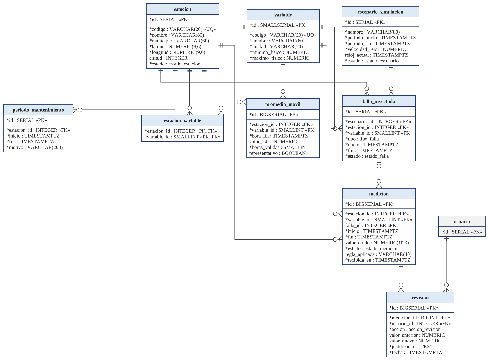
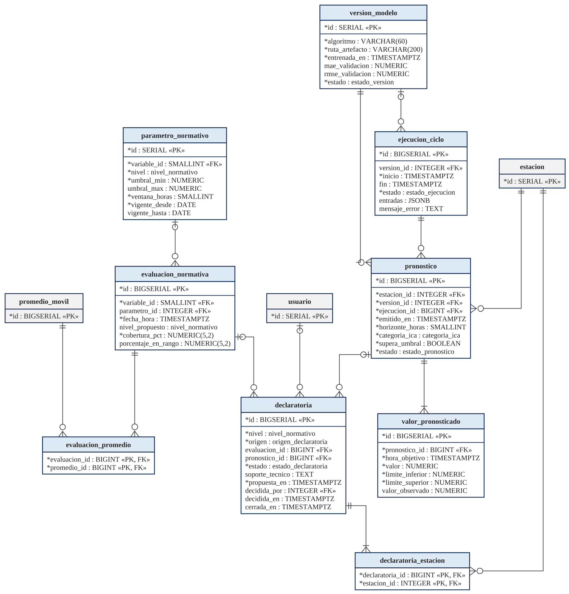
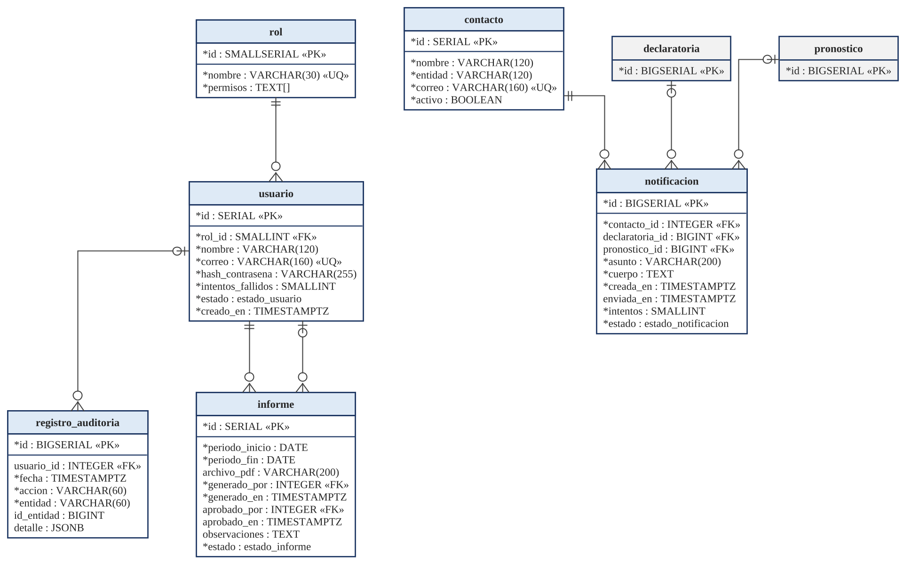

<!-- Generado por tools/docx_a_conocimiento.py desde el .docx. No editar a mano: editar el Word y regenerar. -->

### 3.6.8 Modelo relacional de la base de datos

El modelo relacional traduce el diagrama de clases a 24 tablas en el esquema svca de PostgreSQL. Las 21 clases se convierten en tablas y tres tablas adicionales resuelven las relaciones de muchos a muchos, que son estacion\_variable, evaluacion\_promedio y declaratoria\_estacion. Las enumeraciones del diagrama de clases se implementan como tipos enumerados, de modo que la base de datos rechaza cualquier estado que no exista en el modelo. La Tabla 18 resume cada tabla y sus relaciones.

**Tabla** **18.** *Tablas del modelo relacional*

|                        |                  |                                                |                                             |
| ---------------------- | ---------------- | ---------------------------------------------- | ------------------------------------------- |
| **Tabla**              | **Paquete**      | **Contenido**                                  | **Referencia a**                            |
| rol                    | Seguridad        | Roles y permisos                               | —                                           |
| usuario                | Seguridad        | Cuentas, contraseña cifrada y estado           | rol                                         |
| registro\_auditoria    | Seguridad        | Acciones de los usuarios                       | usuario                                     |
| estacion               | Red de monitoreo | Estaciones con coordenadas y estado            | —                                           |
| variable               | Red de monitoreo | Variables con unidad y rango físico            | —                                           |
| estacion\_variable     | Red de monitoreo | Variables que mide cada estación               | estacion, variable                          |
| periodo\_mantenimiento | Red de monitoreo | Intervalos de mantenimiento                    | estacion                                    |
| escenario\_simulacion  | Simulación       | Periodo, velocidad del reloj y estado          | —                                           |
| falla\_inyectada       | Simulación       | Fallas programadas por escenario               | escenario\_simulacion, estacion, variable   |
| medicion               | Datos            | Mediciones horarias con valor crudo y bandera  | estacion, variable, falla\_inyectada        |
| revision               | Datos            | Decisiones del técnico sobre datos sospechosos | medicion, usuario                           |
| promedio\_movil        | Datos            | Promedios de 24 horas y representatividad      | estacion, variable                          |
| version\_modelo        | Pronóstico       | Versiones entrenadas y sus métricas            | —                                           |
| ejecucion\_ciclo       | Pronóstico       | Trazas de cada ciclo diario                    | version\_modelo                             |
| pronostico             | Pronóstico       | Pronóstico por estación y día                  | estacion, version\_modelo, ejecucion\_ciclo |
| valor\_pronosticado    | Pronóstico       | Valores horarios con intervalo y observado     | pronostico                                  |
| parametro\_normativo   | Normativo        | Umbrales por nivel y vigencia                  | variable                                    |
| evaluacion\_normativa  | Normativo        | Resultado de cada evaluación horaria           | variable, parametro\_normativo              |
| evaluacion\_promedio   | Normativo        | Promedios usados en cada evaluación            | evaluacion\_normativa, promedio\_movil      |
| declaratoria           | Normativo        | Propuestas y decisiones de nivel               | evaluacion\_normativa, pronostico, usuario  |
| declaratoria\_estacion | Normativo        | Estaciones que cubre cada declaratoria         | declaratoria, estacion                      |
| contacto               | Difusión         | Destinatarios de las notificaciones            | —                                           |
| notificacion           | Difusión         | Mensajes enviados y su estado                  | contacto, declaratoria, pronostico          |
| informe                | Difusión         | Informes mensuales en PDF                      | usuario                                     |

Fuente: Elaboración propia.

El protocolo nacional recomienda conservar una base con todas las mediciones y otra solo con los datos válidos. El modelo resuelve esa recomendación sin duplicar información. La tabla medicion guarda todas las mediciones con su valor crudo, un disparador impide modificar ese valor y la vista v\_medicion\_valida entrega solo los datos habilitados, con el valor corregido cuando existe una revisión. Las restricciones de la base de datos refuerzan las reglas del dominio. Una medición no puede repetirse para la misma estación, variable y hora, una revisión exige justificación, una corrección exige valor nuevo, una declaratoria por pronóstico exige el pronóstico que la originó y solo una versión del modelo puede estar activa.

El diagrama entidad relación se presenta en tres figuras con notación de pata de gallo. Las tablas de otro grupo aparecen en gris y solo con su clave primaria. La Figura 44 cubre la red de monitoreo, los datos y la simulación, la Figura 45 el pronóstico y el componente normativo, y la Figura 46 la difusión y la seguridad.

**Figura** **44.** *Diagrama entidad relación de red de monitoreo, datos y simulación*

Fuente: Elaboración propia.

**Figura** **45.** *Diagrama entidad relación de pronóstico y componente normativo*

Fuente: Elaboración propia.

**Figura** **46.** *Diagrama entidad relación de difusión y seguridad*

Fuente: Elaboración propia.
